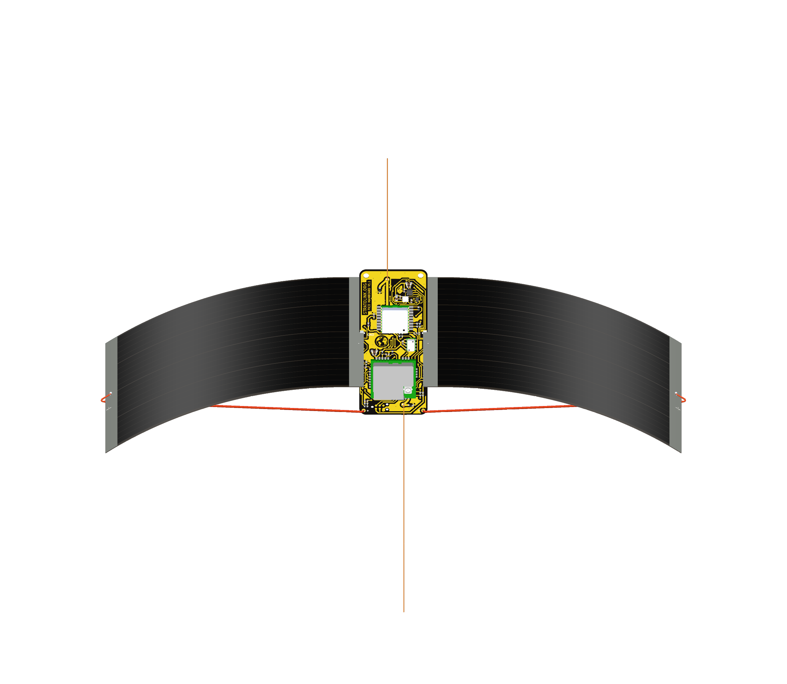

# Bare-board finish, duplicate VSTOR segment and antenna assembly

This step starts at `41027a4` on `alpha/hardware-v1.1` and implements Teddy's explicit preference for **no solder mask on either face**. The canonical project is `hardware/pcb/stratolink.kicad_pro`. Earlier green-mask and mask-web assumptions are historical and superseded for this revision. Copper clearances, pad annuli and stencil paste remain separate requirements.

## No solder mask

KiCad's F.Mask/B.Mask graphics describe **openings**, not deposited coating. A blank mask file would not correctly describe the requested completely exposed board. The selected representation and exported coverage checks are documented in the [mask report](mask/README.md). Fabrication instructions must explicitly request no solder mask on both faces; retain the full-opening mask outputs in the review package so the intent is inspectable.

Only the `solder_mask_bridge` severity changes to `ignore`: merged openings are intentional everywhere on a maskless board. The raw audit with this check enabled remains in the evidence; its representative count varies on identical inputs and is not an acceptance criterion. Copper-clearance checks and other severities are unchanged. Four new silkscreen warnings identify the existing `GND`/`+` labels over the full opening. None crosses a solder pad; the labels remain, with bare-board legend retention a CAM check.

The nominal finished thickness remains 0.40 mm with 35 µm copper on both faces. Removing the two nominal 10 µm mask layers changes the stackup metadata to a 0.33 mm FR4 core. This is the selected CAD stackup, not a measurement of the flown board or a supplier-certified construction.

## VSTOR duplicate

The flagged segment is only **0.0113 mm** long, at `(75.187, 67.249)` → `(75.195, 67.257)` mm. It lies wholly inside another 0.25 mm-wide VSTOR segment on F.Cu, with the same start and direction. Delete the redundant object; preserve the continuous route. [Exact UUIDs and geometry](stub.json).

## Assembly and combined review

Teddy confirmed both antennas are **straight enameled copper wire cut to different lengths**, superseding the inherited spring/chip antenna metadata. His [published assembly instructions](https://stratolink.org/docs/hardware#antennas-and-suspension), checked on 2026-10-12, identify AE1 as LoRa and AE2 as GNSS. Their starting lengths, measured from the feed, are:

| Antenna | Starting length |
| --- | ---: |
| AE1, 915 MHz | 82 mm |
| AE1, 868 MHz | 86 mm |
| AE1, 868–928 MHz compromise | 83 mm |
| AE2, GNSS L1 | 48 mm |

The reference models use 82 mm LoRa and 48 mm GNSS. The LoRa assembly envelope reserves space for the longer listed options. Wire diameter and the below-feed soldering tail are nominal assembly-model assumptions, not measurements of the flown payload. Preserve the feed locations and wire directions; these lengths are starting dimensions, not a measured impedance match of the final solar/payload assembly.

The [diode/antenna assembly report](assembly/README.md) records the body/lead clearance and selected correction. The [independent review](review/README.md) records the exact change inventory, full physical-pad connectivity, fresh DRC signatures and manufacturing outputs. This is a scoped CAD revision; remaining component identity, supplier-rule and physical pilot checks remain in the [hardware checklist](../../hardware/pcb/TODO.md).

The independent comparison preserves all **232 physical-pad connected sets**, with **zero opens**. Every surviving track, via and pad retains its exact copper polygon. Removing the duplicate leaves no distinct copper; after refill, back copper is exact and front copper differs only by approximately 3.19×10⁻⁸ mm² of polygon boundary residue, bounded within 50 nm. Paste, outline and drill exports remain identical after timestamp normalization.

Saved project DRC remains **55 findings**: two antenna library mismatches, the false spring-courtyard overlap and the duplicate segment warning are removed; four warnings concern the unchanged labels over the newly exposed surface. Schematic parity remains at the same 11 inherited findings. The retained-net-class clearance diagnostic remains 110; the original 0.50 mm edge-policy diagnostic remains 91. Raw mask-enabled runs have many intentional merged-opening reports with variable representative counts; see the independent report rather than interpreting those as electrical shorts or comparing their totals alone.

Candidate and final canonical file hashes are recorded in `candidate.json` and `promotion.json`. [Fabrication intent](../../hardware/pcb/FABRICATION.md) explicitly carries the no-mask preference. No manufacturing order is part of this step.

Final text cleanup removes tabs from 21 otherwise blank PCB lines and 18 blank lines in each new footprint. The complete parsed board and footprint trees are identical to the frozen reviewed candidate, and all other 88 project/library files are byte-identical. [Finalization record](formatting-finalization.json) distinguishes the byte hashes; the native results and overview therefore describe the same final geometry. The builder reproduces the normalized files in external `combined-final` scratch.
