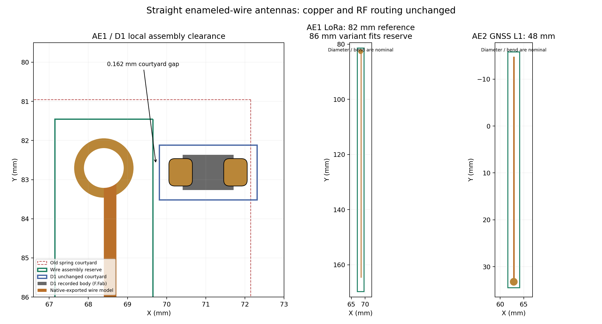

# Wire antenna assembly geometry

The D1/AE1 courtyard finding came from a spring-antenna drawing retained on a board that uses a straight enameled copper wire. Teddy confirmed that **both AE1 and AE2 are straight enameled copper wire cut to length**. The published [Stratolink antenna assembly instructions](https://stratolink.org/docs/hardware#antennas-and-suspension), inspected in the in-app browser on 2026-10-12, specify lengths measured from the feed point: **82 mm for 915 MHz LoRa**, **86 mm for 868 MHz**, **83 mm for the 868–928 MHz compromise**, and **48 mm for GPS L1**. AE1 connects to LoRa at the lower board end; AE2 connects to GNSS at the upper end.

The candidate preserves the existing antenna holes, copper lands, all RF routing, D1 and D3 positions, model rotations and offsets. It replaces both obsolete spring outlines with straight-wire assembly drawings and new project-local footprints. PCB and schematic value, description and source-link fields now describe wire antennas, removing the unrelated Adafruit/Johanson part identities. This is not a new purchased antenna substitution.

## Dimensions and assembly margin

| Item | Updated drawing/model | Courtyard reservation |
| --- | --- | --- |
| AE1, LoRa | 82 mm feed-to-tip 915 MHz reference | 87 mm outward, covering the documented 86 mm option plus 1 mm |
| AE2, GNSS | 48 mm feed-to-tip GPS L1 reference | 49 mm outward, providing 1 mm tip margin |
| Both mounting points | Existing 1.50 mm copper land, 1.00 mm hole | 1.25 mm each side and behind the feed, leaving 0.50 mm beyond the land |

The **0.321 mm model diameter** and **2 mm bent insertion leg** are inherited nominal dimensions, not measurements of Teddy's wire or assembly. The STEP files extend only the straight portion to the published lengths. Full antenna cut length includes the separately formed insertion leg; published RF lengths are measured from the feed. Strip enamel at the solder joint. Actual diameter, bend, solder fillet and trim remain physical assembly checks.

The native KiCad-exported 3D mesh projects outboard in the board plane: AE1 downward and AE2 upward. Both full model projections, including their bent insertion legs and existing offsets, fit inside the new courtyards. The mesh's minimum courtyard margin is approximately **0.929 mm for AE1** and **1.000 mm for AE2**. Coordinate serialization explains the sub-micrometre numerical deviations in exported lengths.

At D1 the two courtyards now have **0.162 mm clearance**. The actual copper-land gap remains **0.911999 mm**, and the recorded diode F.Fab body is **1.691 mm** from the nominal wire-model projection. These are different measurements: courtyard margin is an assembly reservation, not a copper clearance or proof of soldering-process capability. Keep the formed wire and solder fillet inside the reserved local envelope; qualification on the pilot still matters. The inherited broad rectangle had a 3.2732 mm² overlap with D1's courtyard because it reserved the spring's full width beside the narrow feed stem.

## Exact change scope and verification

`candidate.json` pins the 41027a4 baseline, frozen scratch directory and hashes. `build_candidate.py` reconstructs it without writing canonical CAD. For each antenna the PCB change is limited to its library identifier, descriptive fields, four courtyard lines, five old fabrication drawing lines replaced by one straight wire line, and the model file path. The component positions and model transforms stay fixed. The schematic changes only Footprint, Value, Datasheet and Description properties for AE1/AE2. Two footprint files and two STEP files are new; every existing local library file remains byte-for-byte unchanged.

Native review in `verify_native.py` checks exact change scope, all **232 physical-pad connected sets**, matching local-library pads, and fresh DRC. The isolated antenna candidate changes the project DRC **55 → 52**, removing only D1/AE1 courtyard overlap and the two antenna library mismatches. It introduces no new findings; opens remain zero and the existing 11 schematic-parity findings remain unchanged.

All nine exported fabrication files—front/back copper, mask, paste, board outline, plated drills and nonplated drills—are identical to the baseline after timestamp normalization. This antenna documentation correction does not change the physical board artwork. The root task separately applies the requested no-mask finish and VSTOR-stub correction.

`plot_geometry.py` checks the complete model vertex clouds exported by native KiCad, includes the model transforms rather than assuming orientation, and records the bounds in [geometry.json](geometry.json). The initial spring and hybrid envelope trials are obsolete scratch candidates; neither is selected or promoted.

## STEP import checks

`verify_models.py` performs a separate Open CASCADE import and boundary-representation validity check. The inherited `gps.step` and both length-corrected STEP files import successfully as **one valid solid with eight faces**. Their native geometry has the expected 45.6/82/48 mm straight lengths, 0.321 mm diameter and 2 mm bent leg. The increase in kernel-computed solid volume agrees with the ideal added cylinder volume within 0.00293%; this is a numerical/source-geometry check, not a measured wire mass.

The STEP reader reports the same inherited metadata warnings for all three files: the FILE_DESCRIPTION description is nested rather than a string, the uncertainty record has a null description, and the PRODUCT frame-of-reference list is empty. These are recorded in [model-kernel-review.json](model-kernel-review.json); there is no missing numeric entity reference, discarded solid or failed BREP validity check. The source geometry and those metadata records are retained in this selected revision. The native KiCad VRML export also produces both complete 188-vertex model meshes, whose projections are checked separately. The report does not claim a warning-free STEP source.
