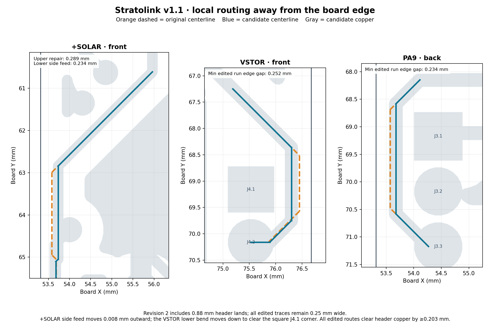

# Near-edge routing and component pad rings

This v1.1 step starts at `d70a53d` on `alpha/hardware-v1.1`. The working project remains `hardware/pcb/stratolink.kicad_pro`. It moves three local routes away from the board edge and increases J3/J4's fourteen copper lands while preserving the existing hole sizes and positions.

## Routing

| Flagged path | Original minimum edge gap | Revised minimum edge gap |
| --- | ---: | ---: |
| +SOLAR, front left, three originally flagged segments | 0.1396 mm | 0.2886 mm |
| VSTOR, front right | 0.1017 mm | 0.2517 mm |
| PA9, back left | 0.1287 mm | 0.2337 mm |

Twelve existing segments change endpoints and one short 45° solar transition is added. All trace widths remain **0.25 mm**. The outer connection endpoints, nets, layers, vias, components, board outline and stackup stay fixed. These are power and MCU signal routes; RF feeds are untouched.

The lower solar feed and transition have **0.2337 mm** minimum edge clearance. The separate unmodified feed remains about 0.209 mm from the edge. The whole solar path therefore does not have a 0.25 mm setback. PA9 uses 0.2337 mm to retain approximately 0.2050 mm clearance to the enlarged J3.1 land; forcing both 0.25 mm edge clearance and 0.20 mm header clearance would exceed the available corridor by about 0.0113 mm. VSTOR retains 0.2030 mm from its vertical run to J4.1 and 0.2144 mm around that pad's square corner. All nine original findings against the **0.20 mm routed-edge requirement** are removed.

The [final routing report](routing/r2/README.md) records exact coordinates, changed UUIDs and clearances against the enlarged headers. The first combined review found two track-to-pad gaps below 0.20 mm; revision 2 corrects both and checks every modified segment against every foreign-net header pad on its layer. The [rejected first combination](rejected-r1/README.md) remains documented.

## Pad rings

J3/J4 are physically **1 mm pitch**, despite their inherited misleading value text. Enlarging their original 0.85 mm pads to 1 mm would make neighbors touch. The selected **0.88 mm lands with unchanged 0.50 mm holes** instead give:

- 0.190 mm nominal minimum annulus, up from 0.175 mm;
- approximately 0.120 mm adjacent copper and green-mask gaps;
- approximately 0.310 mm minimum from a header hole to foreign-net copper;
- the same component/wire insertion geometry and drill output.

The ring exceeds JLC's **0.18 mm absolute minimum for two-layer 1 oz**, but remains below its preferred 0.25 mm. The 1 mm pitch prevents reaching the preferred ring while keeping the holes and conductor separation. A 0.90 mm land leaves only approximately 0.10 mm between mask openings, so 0.88 mm was selected for a more balanced margin. The approximately 0.12 mm mask web meets the published 0.10 mm minimum for 1 oz green/red/yellow/blue/purple mask; it does **not** meet the 0.13 mm black/white minimum. Keep the reviewed green-mask process. These are nominal CAD checks, not measured finished-board strength.

Separate project-local left/right footprints preserve the exact placed geometry, including its small differences. Only their land dimensions and library identifiers change on the PCB; only the two footprint references change in the schematic. Existing schematic value labels remain an explicit metadata follow-up. All previous library files are untouched. Ordinary vias and U1's thermal vias are evaluated as vias, not component-lead holes.

[Ring audit and alternatives](rings/README.md) · [Manufacturer limits and interpretation](sources/README.md).

## Verification and interpreting the DRC counts

| Profile | Baseline | Combined candidate |
| --- | ---: | ---: |
| Saved project rules | 57 | 55 |
| Prior diagnostic: every net class at 0.15 mm, routed edge at 0.20 mm | 70 | 70 |
| Diagnostic retaining original net-class clearances, routed edge at 0.20 mm | 121 | 110 |
| Original 0.50 mm edge constraint enabled separately | 92 | 91 |
| Opens, every profile | 0 | 0 |
| Schematic/PCB parity findings, every profile | 11 | 11 |

The project count drops by two because the J3/J4 placed footprints now match their local libraries. The nine 0.20 mm edge violations disappear in both enabled diagnostics. The stricter diagnostics also report the intentionally smaller header-pad gaps: a 0.12 mm gap is below their generic 0.15/0.20 mm settings. Their exact added/changed signatures are retained and assessed against separate, sourced geometry limits; they are not hidden by relaxing the canonical rules. Counts alone do not prove improvement or fabrication acceptance.

The stored 0.50 mm edge policy remains unchanged and ignored in the canonical project. Its separate audit still flags these corridors, including the additional transition object. This step satisfies the sourced 0.20 mm routed-edge capability; it does not claim a 0.50 mm setback throughout the board. Supplier-specific release rules remain a checklist item.

The independent review checks all **232 physical-pad connected sets**, exact change scope, every header's ring/mask/hole geometry, actual route clearances, and fresh manufacturing exports. Front/back paste, board outline and both drill files remain identical after timestamp normalization. Copper and mask changes are confined to the reviewed local geometry and fill consequences, apart from polygon comparison residues bounded by 50 nm on the front and 2 nm on the back. The detailed comparison records these rather than claiming exact copper identity. A small remote fill corner in the rejected first combination is absent from the selected revision.

- [Independent combined review](review/README.md)
- [Native verification](review/verification.json)
- [Baseline and candidate manufacturing outputs](review/review-exports.zip) — review artifacts, not a fabrication release
- [Current checklist](../../hardware/pcb/TODO.md)

## Reproduction and canonical update

`routing/build_candidate.py` and `rings/build_candidates.py` reconstruct the isolated first candidates from the pinned Git baseline. `routing/build_candidate_r2.py` applies the two integration corrections; see its report for the frozen inputs. The root `build_candidate.py` combines only the twelve changed and one added routing segments with the selected ring candidate. It writes under `~/Repositories/ai-working/scratch/stratolink-edges-20261012/combined-r2` and never writes canonical CAD. `candidate.json` records source and candidate hashes.

Promotion copies only the reviewed PCB, schematic footprint metadata and two new local footprints into `hardware/pcb`, then reloads the project in KiCad. `promotion.json` records final file hashes, fresh canonical DRC and preservation of the 100 unrelated tracked changes captured in `before.json`. Physical pilot checks and other fabrication findings remain open. No order or remote publication is part of this step.
