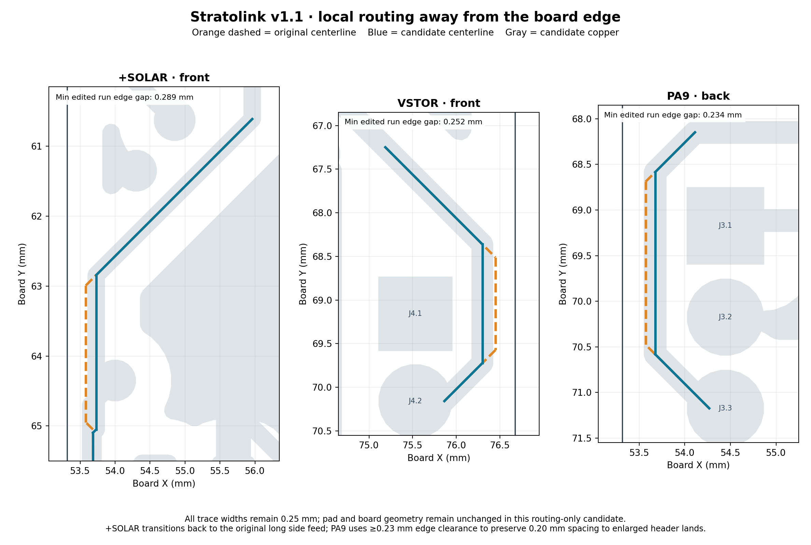

# Local copper routing away from the board edge

**Selected revision: [r2](r2/README.md).** The original routing-only snapshot below passed against the old header lands. Integration with 0.88 mm header lands exposed two sub-0.20 mm track-to-pad gaps; r2 corrects both and supersedes this snapshot for promotion. Original evidence remains unchanged for traceability.

This routing-only candidate removes all **nine** enabled 0.20 mm copper-to-edge findings from the `d70a53d` baseline. It changes ten existing segment geometries and adds one short segment; every trace width remains **0.25 mm**, and the outer endpoints of all three modified paths are identical. No footprints, vias, arcs, board outline, schematic, project rules, zone settings, or unrelated routing are changed. Zone fill is regenerated by native KiCad.

Candidate: `/Users/twarn/Repositories/ai-working/scratch/stratolink-edges-20261012/routing/candidate/stratolink.kicad_pcb`.

SHA-256: `92e890fad45ce4717198d4777afe6665475c000d052fc04f524eadbc17c878c5`.

| Path | Before minimum edge gap | After minimum edge gap | Scope |
|---|---:|---:|---|
| +SOLAR, front left | 0.1396 mm | 0.2886 mm in the three flagged segments | Move the short run to x=53.730 mm; transition back to the existing side feed |
| VSTOR, front right | 0.1017 mm | 0.2517 mm | Move the short run to x=76.299 mm |
| PA9, back left | 0.1287 mm | 0.2337 mm | Move the short run to x=53.675 mm, preserving clearance to J3 |

These are power and MCU signal routes, not the RF feed. All three local paths become slightly shorter: +SOLAR by 0.0847 mm, VSTOR by 0.1243 mm, and PA9 by 0.0870 mm. No route is narrowed. The adjacent return copper refills locally; whole-board native connectivity remains identical, including every ground pad.

## Why PA9 uses 0.23 mm, and the solar transition is 0.242 mm

The separately proposed 0.88 mm J3/J4 lands constrain the corridor. The unchanged J3.1 center is x=54.444998 mm; a 0.88 mm square land, 0.25 mm track, 0.20 mm inter-net clearance, and 0.25 mm board-edge clearance require about 0.0113 mm more room than is available. The chosen PA9 center instead retains **0.2050 mm** nominal clearance to the proposed J3.1 land while clearing the board edge by **0.2337 mm**. The VSTOR center leaves **0.2030 mm** to the proposed J4.1 land and **0.2517 mm** to the edge. Both exceed the parent-verified 0.20 mm routed-edge fabrication minimum; these are nominal CAD dimensions, not a process-tolerance guarantee.

The old +SOLAR side corridor contains overlapping x=53.650 and x=53.683171 mm routes. Their nominal board-edge gaps are approximately 0.209 and 0.242 mm and were not among the nine findings. The repair leaves that corridor in place, changes only the upper endpoint of segment `c1227579-013e-4ffa-b72b-869589a0d2ea`, and adds one short 45-degree transition. That transition has a 0.2418 mm minimum edge gap. This deliberately avoids moving the entire power route closer to J3 or cleaning unrelated overlapping geometry.

## Verification

| Native check | Baseline | Candidate | Delta |
|---|---:|---:|---|
| Project-rule DRC findings | 57 | 57 | No added or removed finding |
| Prior diagnostic: enabled 0.15 mm spacing / 0.20 mm edge | 70 | 61 | Exactly nine edge findings removed |
| Retained-netclass diagnostic: original 0.20 mm class / 0.20 mm edge | 121 | 112 | Exactly nine edge findings removed |
| Unconnected items | 0 | 0 | None |
| Schematic-parity findings | 11 | 11 | Unchanged |

Both diagnostics enable clearance, annular-width, and edge checks, set minimum clearance to 0.15 mm and minimum track width to 0.10 mm, and retain the actual project's other settings. The prior screen also sets netclass clearance to 0.15 mm; the retained-netclass screen leaves its existing 0.20 mm value intact. Those retained-class results preserve the **55 pre-existing clearance findings** rather than hiding them. Project DRC still has 55 library mismatches, one overlapping courtyard, and one dangling track. This candidate is a bounded edge repair, not a whole-board clean-DRC claim.

All **232 physical pads**, representing **228 logical pad nodes**, retain the exact same complete connected-pad sets. All non-route objects are exactly equal after parsing, and all unchanged segments are exactly equal. This includes TMP117 repair, U7 pad/mask/thermal settings, both suspension holes, solar notches, and RF copper geometry. The schematic and project file are byte-identical.

Full native copper comparison, including refill, finds 0.372734 mm² added / 0.549034 mm² removed on the front and 0.187691 mm² added / 0.209437 mm² removed on the back. The substantial changes are confined to the three local corridors and their adjacent fill. Raw polygon comparison retains tiny polygonization/union differences, including remote parts below 0.00001 mm²; the raw bounds and every component area are recorded rather than suppressed. Unchanged underlying route/pad objects are independently checked exactly.

## Reproduction and integration

Run `build_candidate.py` with the analysis virtualenv to reproduce the Git-pinned scratch baseline and candidate. Run `verify_native.py` with KiCad's bundled Python, then `measure_and_plot.py` with the analysis virtualenv. The scripts only write this evidence directory and the dedicated scratch directory.

`build.json` identifies every modified and added segment UUID. `native-review.json` holds exact object/connectivity checks and all DRC deltas. `geometry-review.json` contains start/end coordinates, measured nearest outline points, route lengths, proposed-ring spacing, and native filled-copper differences. `native_geometry.json.gz` is the reproducible geometry input to the plot and measurements. Raw baseline and candidate DRC reports are retained for all three screens.

For integration with the separately reviewed ring candidate, copy only the ten named segment blocks and the one added segment, then refill and repeat native checks on the combined result. Do not replace the ring candidate's footprints, library, schematic metadata, or project files with this routing-only snapshot.
