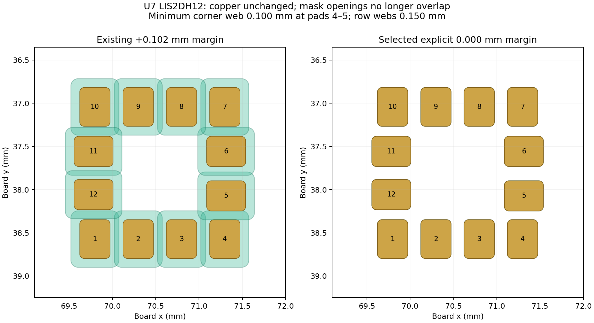

# U7 solder-mask correction

2026-10-12 · baseline `a9d6ed5` · independent candidate review.

The root agent subsequently applied these twelve mask edits and the reconciled U7 library to canonical `hardware/pcb`, preserving the newer suspension-hole change. See [combined integration evidence](../integration/README.md). Candidate hashes below identify the isolated review, not the later combined board.

**The minimal mask-only candidate uses an explicit 0.000 mm solder-mask margin on all twelve U7 pads**, retaining the working copper, paste, position, pinout and routing. It is supported by the selected JLC process, but full ST assembly-guideline conformity remains unresolved as described below. This removes the eight reported mask-bridge errors. Reconcile only U7's project-local reusable footprint from that corrected placed footprint so a future library refresh preserves the same geometry.

## Part identity and source limits

The schematic and placed footprint call for **STMicroelectronics LIS2DH12TR**, a 12-terminal 2 × 2 × 1 mm LGA accelerometer. The imported footprint is named `lib:PQFN50P200X200100-12N` and carries SnapEDA provenance; the name is not proof that the part is a different QFN package. The local STEP model is `LIS2DH12TR.step`. This audit identifies the CAD part, not the laser marking on a physical fitted component.

The [ST datasheet](https://www.st.com/resource/en/datasheet/lis2dh12.pdf) identifies the device and package. ST's [specific footprint discussion](https://community.st.com/mems-sensors-48/smd-footprint-recommendation-for-lis2dh12-17984) recommends the validated STEVAL-MKI151V1 pattern when generic documents and imported models disagree. The current imported copper is **not asserted to be ST's recommended pattern**. Replacing that working land pattern is separate from this local mask repair. [Captured ST guidance](sources/st-footprint-guidance.txt).

## Exact geometry and selected process

All copper pads are rounded rectangles with radius ratio 0.15. Eight pads are 0.45 × 0.35 mm; four are 0.35 × 0.45 mm. Most row centers are on 0.5 mm pitch. Corner gaps are smaller, and pad 5 has an existing 0.015 mm inward offset that is deliberately preserved.

| Item | Previous | Selected |
| --- | ---: | ---: |
| Explicit mask margin, each side | +0.102 mm | 0.000 mm |
| Main mask opening | 0.654 × 0.554 mm | 0.450 × 0.350 mm |
| Transposed mask opening | 0.554 × 0.654 mm | 0.350 × 0.450 mm |
| Mask opening corner radius | 0.0831 mm | 0.0525 mm |
| Row mask web | −0.054 mm, overlap | 0.150 mm nominal |
| Smallest corner web, pads 4–5 | Overlap | 0.100 mm nominal |
| Other nearest corner webs | Overlap | 0.115 mm nominal |
| Nearest foreign-net non-U7 copper | About 0.048 mm | At least 0.150 mm |

The mask opening radii above come from the actual Gerber aperture macros: KiCad retains the round-rectangle radius ratio while expanding its dimensions. A simple polygon offset would predict the wrong expanded corner shape. The study explicitly follows the plotted aperture behavior. Native DRC reports eight different-net mask bridges; the geometric aperture overlap screen is more exhaustive and is not claimed to have a one-to-one count with DRC findings.

[JLCPCB's current capabilities](https://jlcpcb.com/capabilities/pcb-capabilities) explicitly allow **1:1 copper-pad/mask-opening size** with its LDI process upgraded in June 2025. The page requires ≥0.09 mm between mask openings and neighboring traces and lists a **0.10 mm bridge/pad-spacing minimum for 1 oz green, red, yellow, blue or purple mask**. It lists 0.13 mm for black/white and 0.20 mm for 2 oz. [Captured process text](sources/jlc-capabilities-mask.txt).

The selected zero margin reaches the published 0.10 mm minimum at one corner; it has **no extra nominal web margin at that corner**. Keep the intended **1 oz green-mask process** and inspect the supplier's new CAM preview for retained corner dams. Do not treat a legacy “reorder” as equivalent: JLC states that reorders follow the previous production file. This repair is not qualified for black/white mask or 2 oz copper without another review.

A superficially modest +0.025 mm mask expansion would produce a 0.100 mm row web but only a **0.050 mm corner web**, so it is rejected. +0.005 mm still leaves only 0.090 mm at the smallest corner. A negative margin would put mask over the copper perimeter and change the solderable area without being needed by the selected process. No such reduction is selected.

[Native aperture and neighboring-copper sweep](geometry-screen.json) · [Exact exported aperture macros](gerber-verification.json)

## Manufacturer assembly-guidance conflict

ST's [TN0018, revision 8, March 2025](https://www.st.com/resource/en/technical_note/tn0018-handling-mounting-and-soldering-guidelines-for-mems-devices-stmicroelectronics.pdf), page 9, recommends placing the solder-mask opening outside the PCB land. **Zero expansion is not positive clearance outside the copper perimeter**, even though JLC explicitly supports plotting a 1:1 opening. Registration error can put mask onto part of the copper; a zero-margin design therefore must not be called compliant with ST's non-solder-mask-defined recommendation.

There is no simple positive scalar expansion that both preserves the present 0.100 mm copper corner gap and retains JLC's 0.100 mm corner dam: every positive margin reduces that dam below the listed minimum. Reconciling both preferences would require a reviewed change to the copper/pitch or to the corner mask construction, or validation against ST's device-specific STEVAL-MKI151V1 pattern. An imported SnapEDA footprint alone does not settle that choice. The zero-margin candidate is a defensible **minimal prototype mask repair**, not a complete manufacturer land-pattern qualification. Root review must explicitly resolve this tradeoff before treating it as a production footprint.

TN0018 also gives a 70–90% signal-pad stencil-area recommendation with a 90–150 µm stencil thickness and guidance against top metal beneath the sensor. The current candidate deliberately retains the existing 1:1 paste apertures and unchanged copper. It does not close those assembly-guideline questions; copper/paste, stencil selection and the device-specific reference layout belong to a separate U7 assembly review. None of this is hidden by reducing the native DRC count.

## Independent verification

- The PCB differs only in the twelve U7 `solder_mask_margin` values: **0.102 → 0**. Every other parsed object remains exact, including all copper pads, tracks, vias, zones, outline, model references, component positions and paste settings.
- Schematic and project settings are byte-for-byte unchanged.
- **All 230 physical-pad connectivity comparisons pass**, with zero unconnected items.
- Native project DRC **70 → 61**; diagnostic 0.15 mm copper / 0.20 mm edge DRC **83 → 74**. Only the eight mask bridges and U7's reusable-library mismatch disappear. No new finding signatures; 11 schematic parity findings remain unchanged.
- Native comparison confirms the rebuilt U7 library's relative pad positions, sizes, layers, corner ratios and mask settings match the placed U7. Its existing STEP reference and model transformation are retained.
- Fresh Gerber exports show **F.Cu, B.Cu, F.Paste, B.Paste and B.Mask unchanged** after removing creation timestamps. F.Mask changes only two aperture definitions, used exclusively by the twelve U7 flashes. Flash positions and all other plot commands are exact.

[Scope/connectivity/DRC evidence and candidate hashes](verification.json) · [Gerber comparison](gerber-verification.json) · [Fresh review Gerbers](review-gerbers.zip)

The three inherited U7 copper corner clearances below the study's conservative 0.15 mm screen remain 0.100/0.115/0.115 mm; they were not waived or silently rerouted. The existing starved-thermal, zone, courtyard, dangling-track, other-library and parity findings also remain. Fewer DRC findings is not a whole-board fabrication release.

## Candidate and reproduction

Checked scratch directory: `~/Repositories/ai-working/scratch/stratolink-u7-mask/candidate/`.

Only these two files belong to this change:

1. `stratolink.kicad_pcb`
2. `lib/PQFN50P200X200100-12N.kicad_mod`

The library is exported from the corrected placed U7 at a normalized origin/orientation, with a generic reference. It reconciles only this part; no other footprint is refreshed. Existing imported descriptive metadata is retained and is not fresh price/availability research.

`build_scratch.py` builds the isolated mask edit from the fixed Git checkpoint. `reconcile_library.py` runs under KiCad's Python and exports only U7 to the scratch library. Native DRC and diagnostic DRC run against those scratch files. `verify_native.py` checks full edit scope, all pad connectivity and DRC deltas. `verify_exports.py` checks the native Gerber comparison. All scripts write only analysis evidence or scratch paths, never canonical CAD.

If another change has already been promoted after `a9d6ed5`, apply the twelve U7 mask edits to that newer board and rerun the checks; **do not replace newer PCB work wholesale with this baseline-derived snapshot**.
