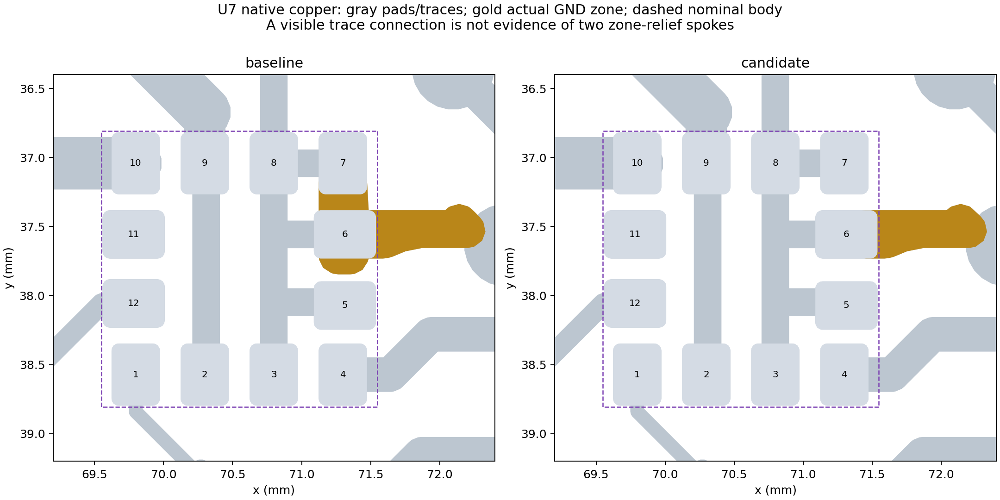

# Independent ground-zone and thermal review

Baseline: `c3d70a4`, 2026-10-12. Independent review of the frozen combined candidate **passed for this scoped change**. Candidate PCB SHA-256: `6a5acb81ba62755336af9854c99c7b035282fa712684ed4815fa456e7ffa5951`. These notes distinguish electrical continuity, soldering behavior and unchanged RF/power geometry. A smaller DRC count alone establishes none of those outcomes.

## Ground-zone scope

The main GND zone `795c4093-4930-4bcb-9c07-8e31d04084fe` is declared on F.Cu and B.Cu, while another GND zone `e9b71a22-0a8a-41f9-b5c4-115945b7ef58` covers B.Cu at the same priority. The reported overlap is a zone-definition conflict, not proof of two manufactured copper thicknesses. The stored baseline has front fill in the main zone and back fill in the separate zone. The zone audit subsequently regenerated both possible consolidations and found identical full front/back copper unions in either case. The selected version removes the redundant B-only zone and refills the retained two-layer zone. This conclusion comes from regenerated copper, not an assumption that stored fill in a deleted object simply survives.

Fresh native refills and the **union of actual copper on each layer** were compared, not just zone polygons, UUIDs or total area. Equal total area can conceal a removed return neck elsewhere. Every retained zone's clearances, minimum thickness, island treatment and thermal settings stayed exact; only the four named pad connection modes changed. The separate zone-only study establishes exact F.Cu/B.Cu equality after consolidation. For the combined change, B.Cu remains exactly equal, while intentional U7/J20 front changes are quantified below. Global clearance and island-removal settings were not altered.

The unnetted two-layer copper-pour keepout `5d0fa8ee-3d1d-47e3-9c6e-f4062953791d` at approximately x64.19–72.56/y32.87–35.57 mm must remain exact. It overlaps the back-side megohm divider region R1–R7; its purpose should not be guessed from its proximity to the upper antenna. Removing it could change copper around high-impedance power-control nodes. Likewise preserve all explicit routes, vias and filled returns around the GNSS antenna feed AE2, LoRa feed AE1 and BQ25570 switching/feedback paths. A tiny local U7 or J20 edit should not be presented as an RF redesign, nor should a connected GND net be assumed to have identical RF return geometry.

## U7: preserve the assembly tradeoff explicitly

U7 is the LIS2DH12 accelerometer, not the TMP117 temperature sensor. Its GND pads are 3, 5, 6, 7 and 8. Baseline DRC reports **one actual thermal spoke where two are required** at pads 5 and 8. All pads inherit the large 0.5 mm global thermal gap and bridge width; their copper dimensions are only 0.35/0.45 mm. The other nearby GND pads and explicit traces already make pad-to-pad heat flow nonuniform.

The selected policy explicitly makes **pads 5, 7 and 8 trace-fed** (`zone_connect 0`). It does not manufacture two new thermal-relief arms. The existing 0.2 mm ground routes remain unchanged. Local thermal-angle/gap trials could remove zone contact while silencing a warning, and changing only pads 5/8 migrated the incomplete-relief condition to pad 7. The explicit three-pad policy captures the actual intended connection instead of relying on that incidental behavior. The minimum required spoke setting remains two, and all twelve copper pads, zero mask margins, paste apertures and placements remain exact.

Native zone/pad intersections confirm zero direct pour overlap and zero pour intersections with contours 0.01, 0.025 and 0.05 mm outside pads 5/7/8. Pad 6 retains one distinct right-hand poured neck and its existing left-hand routed connection. The thermal agent's [minimum-four diagnostic](../thermals/verification.json) reports two resolved conductive directions for pad 6; that result must not be described as two separate poured spokes. Disabling all five GND pads' zone connections was rejected because it disconnected the nearby via's front connection. The [trace-only extraction](../thermals/verification.json), with all pours removed on a separate copy, shows all five U7 grounds still reach C19.1, C21.1, R5.2 and two GND vias through the unchanged explicit routes. This is a routing-specific assembly choice; the matching project-local library overrides are not generic LIS2DH12 package guidance.

The earlier [U7 review](../../v1_1_fabrication_20261012/mask_u7/README.md) records ST's guidance concerning top metal beneath MEMS devices, mask clearance and stencil area. Those items remain open, including inherited 0.100/0.115 mm corner-pad gaps. Total F.Cu under the nominal 2 × 2 mm body decreases **2.533979 → 2.458207 mm²**. Zone copper beneath its central 1.4 mm square becomes zero, but **1.028319 mm² of fixed pad/trace metal remains there**. Removing that zone copper does not mean the top-metal guidance is fully satisfied. No meaningful new U7 copper is added; the area's removal is about 0.075892 mm² including nearby fill. These are geometric results, not a prediction of reflow temperature. The board lacks the material/oven/contact data needed to predict solder-joint temperatures from area alone. The accelerometer's post-reflow offset/stress behavior remains a physical check; no claim of improved temperature sensing follows from this repair.

## J20: this is a pogo contact

J20 is `Connector:Tag-Connect_TC2030-IDC-NL_2x03_P1.27mm_Vertical`. Its six copper contacts are KiCad `connect` pads on F.Cu/F.Mask, without paste apertures. The three nearby holes guide the plug. Pin 5 is GND. The [flight-recovery runbook](../../diagnostics/STRATOLINK1_FLIGHT_RECOVERY_RUNBOOK_20260830.md) explicitly uses a TC2030 SWD cable and retaining clip/jig; [bench notes](../../network/bench/RESULTS.md) describe contact drops during hand-held sessions.

A **local solid ground connection on J20.5 is appropriate** because this pad is normally contacted by a spring pin rather than a reflowed component. The candidate selects that mode (`zone_connect 2`), adding approximately **0.525221 mm²** of local front copper. There is no normal solder joint whose reflow balance requires thermal isolation. The contact diameter, mask opening, guide holes and absence of paste remain exact; surface finish remains a fabrication choice. Do not add solder or treat it as a fitted header. If someone later hand-solders a temporary lead, the larger heat sink is a rework consideration, not a reason to preserve a starved relief on the normal pogo interface.

A solid GND pad does not fix a poorly retained programming cable. Cable retention and clean contact surfaces remain separate from copper connectivity.

## Independent acceptance checks

The frozen combined candidate was checked against a Git-pinned baseline with **80 regular copied library files**, not symlinks to subsequently modified canonical libraries. Both native DRC baselines and manufacturing plots came from those snapshots. The [manifest](baseline-manifest.json) records the baseline file hashes; [verification.json](verification.json) records the guarded candidate source hashes and results.

- Exact scope: deletion of `e9b71a22…`, U7.5/.7/.8 no-zone overrides, J20.5 solid override. All other board objects, nets, placements, explicit routes and vias stayed exact. The schematic, project and library tables stayed byte-identical.
- All **232 physical-pad UUID connectivity sets** stayed equal, including separate physical lands sharing a pin number. Zero opens; no previously disjoint pad groups merged.
- Fresh project DRC **61 → 57**. Independent diagnostic DRC **125 → 121**, with baseline net-class clearances retained, global minimum clearance 0.15 mm, edge clearance 0.20 mm and those two severities enabled. This diagnostic differs from the earlier all-net-classes-at-0.15-mm screen. Both comparisons remove exactly the same three thermal findings and one overlapping-zone finding; **no new signatures**, zero opens, 11 unchanged parity findings. The two-spoke rule remains two. These findings are not a clean whole-board DRC result.
- Full B.Cu copper union is **exactly equal**. Front changes are limited to U7/J20 after an explicit **2 nm boundary tolerance**: raw remote XOR residue is 0.000000892 mm², and none remains outside a 2 nm buffer of the baseline/candidate boundaries. This distinguishes native integer-polygon rounding from a fabricated return-path change. Raw additions/removals and review boxes are preserved in [copper-verification.json](copper-verification.json). The unnetted keepout remains exact; antenna and power routes were not modified.
- Front/back mask and paste, board outline and both drill exports are **identical after creation timestamps are normalized**. The [export archive](review-exports.zip) preserves both versions. The copper-contact plot above was inspected separately from DRC.
- The full reusable U7 footprint syntax tree differs only in `zone_connect 0` on pads 5/7/8; all other library files remain exact. J20's override is instance-local. No blanket stock-library refresh was performed.

Reproduction scripts are [verify_native.py](verify_native.py) (KiCad's bundled Python) and [check_copper.py](check_copper.py) (`analysis/.venv/bin/python`). Copied projects and pinned libraries are outside the repo at `/Users/twarn/Repositories/ai-working/scratch/stratolink-zones-20261012/review`. They were moved unchanged after the native checks; their exports, manifests and guarded source hashes remain valid.

These checks make the local electrical/fabrication change reviewable. They do not close inherited U7 assembly guidance, physical soldering performance or whole-board manufacturing readiness.
