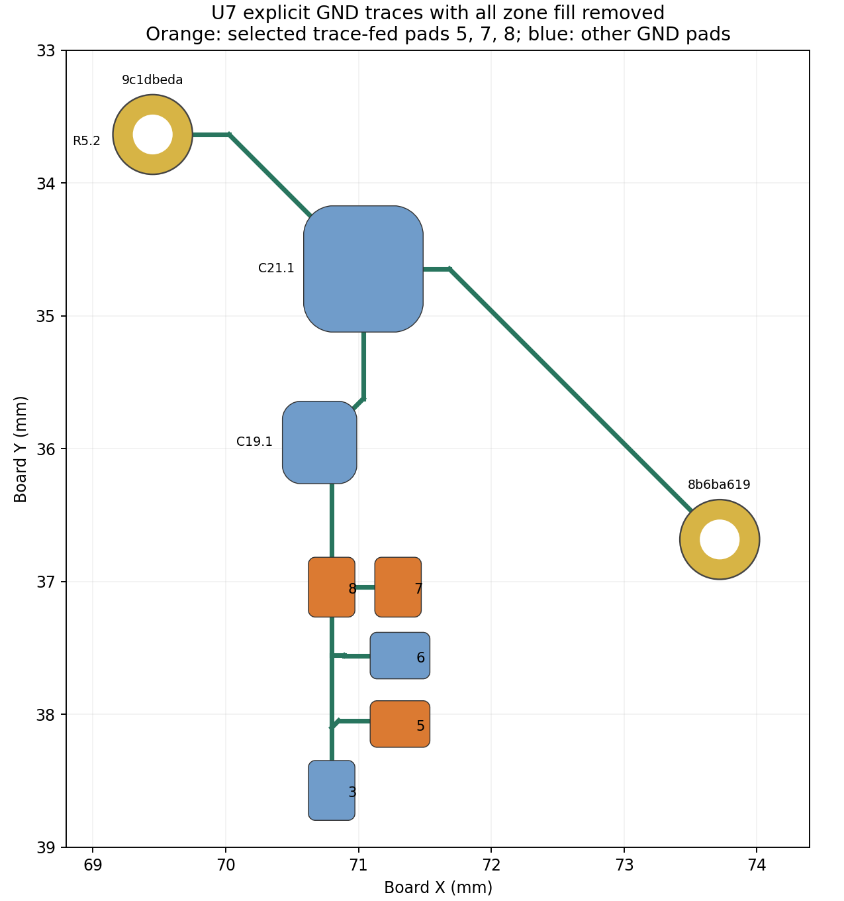

# U7 trace-fed ground audit

2026-10-12 · read-only baseline `c3d70a4`, PCB SHA-256 `268f5ef0f8d59caf0a46a0cb990fb26c1d74563e3423a15c16d361d392f9f96c`.

**U7 GND pads 3, 5, 6, 7 and 8 already have explicit 0.20 mm copper traces to two ground vias.** Their grounding does not rely on a zone thermal at any of those pads. This supports the selected intent: **zone-connect none on pads 5, 7 and 8**, retaining the original zone-relief behavior on pads 3 and 6. The trace-fed choice should be represented explicitly as such, rather than described as two thermal spokes. No CAD or production candidate was edited by this audit.

The parent candidate initially considered pads 5/8 alone; the native thermal warning then moved to pad 7. The reviewed selection therefore includes **5/7/8**, which are all on the same proven trace network. Final native refill and full connected-node verification remain the parent's combined-candidate checks. Setting every ground pin to none is not required by these findings.

## What the zone-free experiment proves

A disposable copy was generated from the pinned Git source, with all three zone objects omitted before native KiCad loaded it. The rest of the board text is unchanged. Neither the canonical board nor a proposed production board is rewritten. This also avoids treating saved zone-fill polygons as evidence for trace continuity.

With zero zones present, native `GetConnectedItems` shows that each of the five pads still reaches the same explicit copper group:

- U7 pads **3, 5, 6, 7, 8**;
- **C19.1**, **C21.1** and **R5.2**;
- via `9c1dbeda-64ec-469f-9930-83c8b6488c88` at **(69.450, 33.635) mm**;
- via `8b6ba619-85cc-4b9e-8cbe-dcff90c1bcc4` at **(73.721, 36.683) mm**.

Both vias have 0.60 mm copper diameter and 0.30 mm finished drill, on both copper faces. The explicit traces run on F.Cu; the left via also joins R5.2 on B.Cu. The parent board's ground pours provide the connection from this local group into the full ground system. The deliberately zone-free experiment does not claim that the entire board remains globally connected without its planes.

## Route lengths and nominal DC check

| U7 pad | To left via: trace length | Nominal trace resistance | To right via: trace length | Nominal trace resistance |
| --- | ---: | ---: | ---: | ---: |
| 3 | 5.977 mm | 14.72 mΩ | 7.498 mm | 18.47 mΩ |
| 5 | 6.042 mm | 14.88 mΩ | 7.563 mm | 18.63 mΩ |
| 6 | 5.476 mm | 13.49 mΩ | 6.997 mm | 17.23 mΩ |
| 7 | 4.947 mm | 12.18 mΩ | 6.468 mm | 15.93 mΩ |
| 8 | 4.447 mm | 10.95 mΩ | 5.968 mm | 14.70 mΩ |

Every counted segment is **0.20 mm wide**. Resistance is the dimensional estimate `Σ ρL/(w t)`, with assumed copper resistivity **1.724 × 10⁻⁸ Ω·m at 20°C** and **35 µm copper thickness**, corresponding to about 2.463 mΩ/mm at this width. Paths allow endpoints inside the same physical pad to join without assigning pad spreading resistance. Segment lengths, full source UUIDs and per-segment resistance are in [paths.json](paths.json). They are route budgets, not exact effective network resistances: vias, solder, package bonds, plane resistance, pad spreading and parallel return paths are omitted. No high-frequency impedance, noise or reflow performance is inferred from the DC calculation.

For an example of the preserved explicit route, pad 8 reaches the left via using segments `b83cdd6f`, `c2b71d8f`, `4bde1a70`, `d77de296`, and `6bee36ac`, through the C19/C21 ground pads. Pad 7 joins that route through `acf3109c`; pad 5 joins through `5dc0585a`, `c542a530`, `84d64290` and `50467fe8`. These are existing traces, not new pour spokes.

This is a sound connectivity basis for a deliberate trace-fed LGA ground connection. It does not by itself establish thermal symmetry during assembly or prove an unchanged RF/switching return impedance after local pour withdrawal. Keeping all explicit traces/vias, retaining pads 3/6's existing zone behavior and checking the final full ground reachability bounds the intended change.

[Native evidence](native.json) · [paths and resistance assumptions](paths.json) · [zone-free extraction](extract.py) · [path calculation and figure](analyze.py). The experiment board is `/Users/twarn/Repositories/ai-working/scratch/stratolink-zones-20261012/trace-audit/without-zones.kicad_pcb`; it is analysis material, not a fabrication candidate.
