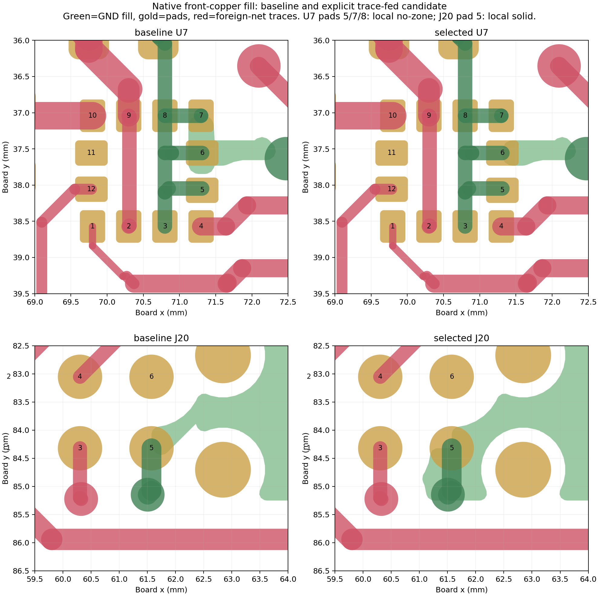

# Local ground-connection decision — 2026-10-12

Use deliberately trace-fed ground pads at **U7.5, U7.7 and U7.8**, and a solid local ground-pour connection at **J20.5**. Keep every component, pad shape, trace, via, mask and paste aperture in place. Keep U7.6's existing connection to the front ground pour. The correction changes four board pad `zone_connect` properties; it does not change thermal gap, spoke width, angle, clearance, minimum spoke count or global zone connection mode.

Baseline: `c3d70a429a95591607341d57bf16ee153972da71`. The thermal-only scratch candidate is `/Users/twarn/Repositories/ai-working/scratch/stratolink-zones-20261012/thermal/trace_only_5_7_8/stratolink.kicad_pcb`, SHA-256 `3a1e394936575f54f7039e6f925b302fea81dc3a9f339b11f305c0e6a22684b6`. Root integrates these four properties with the separately checked removal of the duplicate back ground zone; this directory does not authorize replacing canonical CAD with an older standalone trial.

## Why this is the selected connection

U7 is the LIS2DH12TR accelerometer in `lib:PQFN50P200X200100-12N`. Its small ground lands inherit the board's 0.5 mm thermal gap and 0.5 mm spoke width; the zone's minimum fill thickness is 0.25 mm. Its routing is already a 0.2 mm ground trace tree. Shrinking gap/width and rotating thermals did not establish a useful independent two-arm ground-pour connection at all of the affected pads. Some trials merely removed zone contact at the original flagged pad and moved the one-spoke violation to pad 7. DRC absence alone was therefore rejected as proof of repaired spokes.

The selected properties are explicit:

| Reference/pad | Local zone connection | Purpose |
| --- | --- | --- |
| U7.5 | None (`zone_connect 0`) | Retain the existing 0.2 mm routed ground connection; avoid a partial pour contact. |
| U7.7 | None (`zone_connect 0`) | Avoid moving a starved pour connection to this adjacent ground land. |
| U7.8 | None (`zone_connect 0`) | Retain the existing 0.2 mm routed ground connection; avoid a partial pour contact. |
| J20.5 | Solid (`zone_connect 2`) | Ground a nonsoldered Tag-Connect pogo contact without an unnecessary solder-heat relief. |

U7.3 and U7.6 retain their inherited settings. U7.6's pour neck preserves the front connection of ground via `51c1f328-946d-4172-abc1-7d27a8edf354` at (72.476, 37.635) mm. Removing zone contacts from **all five** U7 ground lands was rejected because that via then acquired a new dangling-via warning. The four-ground version 3/5/7/8 also passed but added an unnecessary property change compared with 5/7/8.

J20 is `Tag-Connect_TC2030-IDC-NL_2x03_P1.27mm_Vertical`, schematic value `Conn_ARM_SWD_TagConnect_TC2030-NL`. Pad 5 is a 0.7874 mm circular **connect** pad, on F.Cu/F.Mask with no F.Paste. Its footprint has a local copper-pour keepout, which remains unchanged. Rotating just this pad's inherited 45° thermal spokes to 0° also passed, but a local solid connection matches its actual nonsoldered function. Nothing is changed in the generic KiCad Tag-Connect library.

## Verification

[Native verification](verification.json) and [reproducible verifier](verify_finalist.py) establish:

- 232 physical pad connectivity checks match the baseline, with unchanged pad nets and no opens.
- With all board-level ground pours removed from a diagnostic copy, all five U7 grounds still reach each other, C19.1, C21.1, R5.2 and two existing ground vias through unchanged 0.2 mm traces. This independently verifies the selected trace-fed path.
- Fresh project DRC is **58 vs 61**, and expanded diagnostic DRC is **71 vs 74**. Exactly the three original starved-thermal findings disappear; no new findings appear. The existing 11 schematic-parity findings are unchanged.
- A scratch-only minimum-four-spoke diagnostic reports **actual 2 at retained U7.6**. The project minimum stays at two. U7.5/7/8 are intentionally not thermal-pour-connected; no claim is made that these pads gained two pour spokes. Native counts are not a substitute for identifying physical copper paths.
- All footprints and board objects match the baseline except those four local properties and regenerated filled polygons. No routing, copper pad dimensions, mask, paste, outline or drill geometry changes.
- Native Gerbers confirm F.Mask, B.Mask, F.Paste, B.Paste, B.Cu and Edge.Cuts unchanged. Both PTH/NPTH drill files are unchanged. Only F.Cu ground fill changes. The standalone exports under [fabrication](fabrication/) are review evidence, **not a final manufacturing package**.

[Geometry measurements](geometry-measurements.json) compare native polygon geometry after refilling both the pinned baseline and selected candidate. Within the U7 nominal 2 × 2 mm body square, total front copper falls from approximately 2.5368 to 2.4611 mm² (0.07563 mm² removed), with no added copper. Dedicated traces and pad metal remain. Ground-fill polygon area alone falls from 0.2931 to 0.0732 mm²; the larger fill change includes portions already covered by fixed traces/pads, so it is not the total manufactured copper change. Manufacturing scope is based on **total copper**, not fill-only polygons. For the standalone candidate, total-copper XOR outside the two declared local regions is 0.000000876 mm², entirely within a 2 nm boundary buffer; B.Cu is exactly unchanged. The independent combined-candidate review supplies the final ROI/quantization result after removal of the duplicate zone. Native polygon evidence is stored as reproducible gzip JSON snapshots (`regions.json.gz` and `selected-regions.json.gz`).

## Bounded trial results

All trial CAD remains outside the repository in scratch. The repository retains result summaries and reproducible scripts.

| Trial family | Outcome |
| --- | --- |
| U7.5/8 gap 0.15, 0.20 or 0.25 mm; width 0.25 mm; 90° | Pad 8 flag removed; pad 5 remains one-spoke. |
| Same gaps/width; both 45° | Original flags disappear but pad 7 becomes one-spoke; physical fill review rejects apparent success. |
| Pad 5 at 45°, pad 8 at 90°, same three gaps | One-spoke finding migrates to pad 7. |
| Additional pad 7 override, 0.25 mm gap/width at 45° or 90° | Pad 7 still one-spoke. |
| U7.5/8 explicit no-zone | Pad 7 becomes one-spoke. |
| All U7 grounds explicit no-zone | No thermal flags, but a new dangling-via warning; rejected. |
| U7.3/5/7/8 explicit no-zone | Passes, but pad 3 change unnecessary. |
| **U7.5/7/8 explicit no-zone** | **Selected: exact three-finding improvement with no added finding.** |
| J20.5 rotate to 0°, original gap/width | Valid alternate; no need for thermal isolation at this nonsoldered contact. |
| **J20.5 local solid** | **Selected: matches contact function.** |

Detailed trial summaries: [initial](trial-results.json), [mixed angles](mixed-trial-results.json), [cluster alternatives](finalist-results.json), [minimal alternatives](minimal-results.json).

## Library and qualification limits

These are **board-position-dependent connection choices**, not a new generic MEMS land pattern. Root's combined candidate mirrors U7's three explicit no-zone properties in the existing project-local U7 footprint so a later library update preserves this board's decision. Preserve the existing zero mask margins, copper dimensions, paste apertures and every other pad property. Keep J20's single override local to this board.

The separate ST land-pattern, positive mask opening and paste-area review remains open. Less under-body pour does not establish compliance with ST guidance: existing routed copper and pads remain under the package. This correction also does not resolve the remaining DRC/parity items, replace fabrication review, or validate assembly/flight behavior. It establishes continuous ground paths and a scoped, explicit connection choice without moving proven routing.
