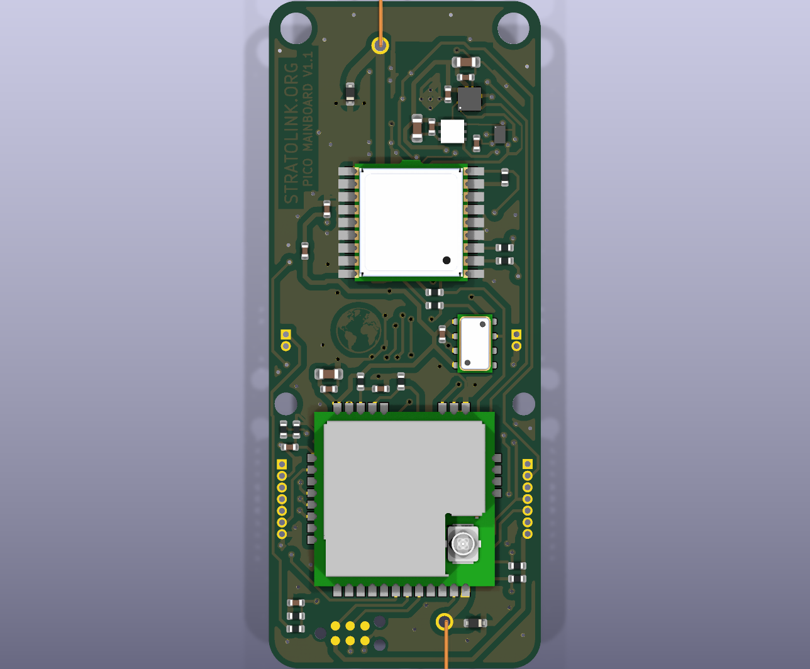

# v1.1 microphone removal

Implemented 2026-10-12 directly in [`hardware/pcb/`](../../hardware/pcb/) on `alpha/hardware-v1.1`, after the TMP117 correction at `38de8d7`. The KiCad project is the same one used for ongoing board review. This change frees the microphone area before the separate side solar attachment work.

## Circuit and layout

- Removed MK1 (T3902), R20 (33 Ω clock series resistor), and C13 (100 nF local bypass) from the schematic and PCB. Removed their CLK/PDM wiring, 18 dedicated signal segments, 11 exclusive ground segments and one ground via. Removed MK1's footprint, including the 0.5 mm acoustic hole and its mask/paste features.
- Marked U2 pins 31/PB4 and 32/PB3 no-connect in both schematic and PCB. Their pad geometry remains unchanged and neither has any connected copper item.
- Added a 0.25 mm supply segment between the track ends previously joined by C13's power pad. This keeps the shared 3.3 V feed to FB1/GNSS continuous.
- Removing the long signal routes changed the surrounding ground fill. Added a short ground connection at U2.28 and a three-segment ground return at R23.2 to preserve good connection to the newly exposed pour under both rule sets. No pad thermal settings, component positions, or project rules were relaxed.
- The saved board has 59 footprints, 228 pad objects, 138 vias and 860 track segments. The corrected TMP117 circuit, solar terminals, board outline and all remaining footprint geometry are preserved.

The exact removed/added objects are recorded in [`changes.json`](changes.json). [`remove_microphone.py`](remove_microphone.py) records the guarded ECO against the frozen baseline; do not run it against later revisions. It deliberately refuses to overwrite subsequent CAD work.



## Verification

Independent native KiCad connectivity checks passed: all 224 retained logical pad identities have the same connected-pad sets, and all 217 retained schematic net nodes are unchanged. U2.31/U2.32 are the two intentional exceptions and are physically isolated. The 228 geometric pad objects include repeated-number and mechanical pads. See the [independent review](review/electrical_review.md) and [machine-readable result](review/comparison.json).

| Check | Before | After |
| --- | ---: | ---: |
| Native DRC using existing project rules | 78: 16 errors, 62 warnings | 73: 14 errors, 59 warnings |
| Separate enabled 0.15 mm clearance screen | 92: 30 errors, 62 warnings | 87: 28 errors, 59 warnings |
| Unconnected PCB items | 0 | 0 |
| Schematic/PCB parity findings | 11 | 11 |
| ERC | 56: 20 errors, 36 warnings | 55: 20 errors, 35 warnings |

The microphone's two mask-bridge errors and three footprint-library warnings disappear. Its missing symbol-library warning also disappears. Remaining findings concern inherited geometry/library issues; the comparison records KiCad's changed choice of representative items for one existing R23 clearance violation and one shared-net ERC warning. This is **not a globally clean DRC/ERC result or a manufacturing release**. See [exact report differences and dispositions](review/drc-comparison.json).

The working project's global clearance checks remain disabled, as before. The separate screen uses [recorded settings](review/screen-settings.kicad_pro) and refilled copies; it does not change the canonical project's rules. Fresh native reports: [DRC](drc-project.json), [ERC](erc-project.json), [screen before](review/clearance_screen/before/drc.json), [screen after](review/clearance_screen/after/drc.json).

## Firmware

Use `platformio run -e stratolink_v1_1` from `firmware/` for the microphone-free board. `STRATOLINK_MIC_PRESENT=0` keeps PB3/PB4 analog with no pulls, avoids SPI capture, and reports the measurement unavailable through the current telemetry implementation. The default `stratolink` environment retains microphone support for the existing v1 boards.

Both actual STM32 builds passed. The production-driver host check and ARM object inspection verify the disabled path performs no SPI operation; the host test also checks unavailable telemetry across all five power tiers. Builds used the existing working-tree firmware, including its pre-existing changes. Only the microphone driver and new build environment were changed by this task. No device was flashed. [Firmware evidence and limits](firmware_review.md), [host verification](test_no_mic_firmware.py).

## Review exports and next step

[`review-exports.zip`](review-exports.zip) contains newly generated copper, mask, paste, silkscreen, edge, drill, BOM and placement files for review (also unpacked locally in `exports/`). The archive preserves the exact native output bytes. MK1/C13/R20 are absent; the NPTH file contains only the three existing 0.991 mm Tag-Connect alignment holes. There is no microphone acoustic drill. The 58 BOM/placement rows retain the design's existing exclusion of J20. Supplier metadata and assembly rotations are not newly qualified here. Historical v1 production files are untouched.

[`exports-manifest.json`](exports-manifest.json) records source and output hashes. The exports are diagnostic; regenerate an approved manufacturing package after the remaining [roadmap](../../hardware/pcb/TODO.md) items are resolved. Next CAD work is the two side solar attachments. Pilot bring-up still needs the matching firmware, quiet-pin/unavailable-telemetry confirmation, and normal operation of the remaining sensors, GNSS and radio.

Re-run the independent connectivity check with KiCad's bundled Python:

```sh
/Applications/KiCad/KiCad.app/Contents/Frameworks/Python.framework/Versions/3.9/bin/python3.9 analysis/v1_1_microphone_20261012/review/check_removal.py
python3 analysis/v1_1_microphone_20261012/review/check_drc_delta.py
python3 analysis/v1_1_microphone_20261012/test_no_mic_firmware.py
```

The connectivity checker reconstructs its baseline from Git when needed. The recorded DRC/ ERC delta checker compares reports; regenerate the native reports for later CAD changes. Baseline/trial CAD copies, logs and build outputs are local scratch evidence rather than alternative working board revisions.
