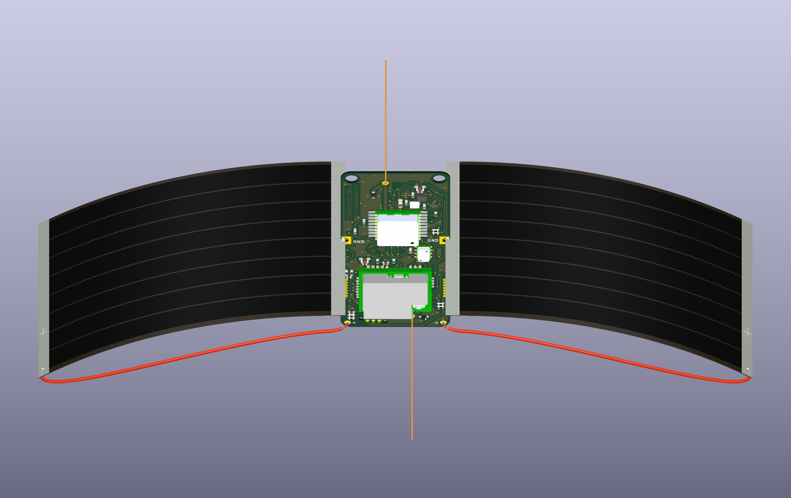

# Solar assembly in KiCad

**Superseded geometry:** the [photo-calibrated mounting revision](../qualification/README.md) now uses 94 × 75 mm panels and 2 mm deep notches. This document and its checks/renderings describe the earlier revision.

The canonical `hardware/pcb/stratolink.kicad_pcb` now includes two project-local solar-panel and wire models attached to J1/J2. This adds only 3D model references; every other parsed PCB object, including all routes, pads, zones and outline geometry, remains identical to commit `14d94de`. The schematic and project settings are unchanged. [Verification](model-only-verification.json).



**The panels' dimensions and bend are illustrative.** The attachment points follow the actual board. This view explains the intended assembly and does not replace the physical terminal measurements or joint qualification already on the hardware checklist.

1. Orient each panel with its **negative terminal inward**. Prepare the solderable metal patch where it crosses the board and seat that face against the upper bank of the side notch. The model shows 1 mm insertion into the straight part of the notch.
2. Join that terminal to the **GND lands on both PCB faces**. The silver root fillets show those two contacts. The notch wall itself is unplated; solder must wet the panel metal and PCB copper. Begin the panel's gentle curve outside the joint.
3. Connect the **outer positive terminal** to its corresponding lower **+ pad** with a lead. The red section shows insulation; the bare end goes through the hole, with solder on the board faces. Both panels remain electrically parallel.

These are visual assembly cues for the provisional mount, not a released process: actual metal exposure, film geometry, bend and soldering method still require a representative trial. In particular, verify panel polarity rather than copying the polarity in ZachTek's original transmitter photograph.

[Ground-joint close-up](ground-joint-detail.png) · [Rear assembly view](assembled-rear.png) · [Model dimensions and regeneration](../../../hardware/pcb/3d/solar/README.md)

## Reproduce the native renders

Run from the repository root:

```sh
kicad-cli pcb render --width 2200 --height 1400 --quality basic --background opaque --rotate '55,0,0' --zoom 0.55 --light-camera 0.55 --output analysis/v1_1_solar_attachments_20261012/assembly/assembled-front.png hardware/pcb/stratolink.kicad_pcb
kicad-cli pcb render --width 1800 --height 1200 --quality basic --background opaque --side bottom --rotate '-45,0,0' --zoom 0.55 --light-camera 0.55 --output analysis/v1_1_solar_attachments_20261012/assembly/assembled-rear.png hardware/pcb/stratolink.kicad_pcb
kicad-cli pcb render --width 1600 --height 1100 --quality basic --background opaque --rotate '40,0,0' --zoom 3 --pan '1.1,-0.35,0' --light-camera 0.55 --output analysis/v1_1_solar_attachments_20261012/assembly/ground-joint-detail.png hardware/pcb/stratolink.kicad_pcb
```

In the live 3D viewer, orbit with the mouse and zoom out enough to include the full panel span. The model is under the Through-hole Models category because it belongs to the manual solar-contact footprints.
