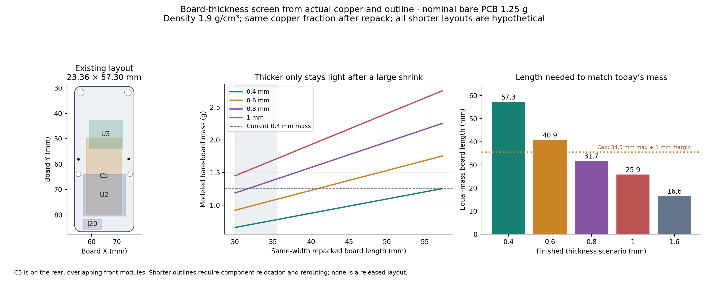

# Thickness, outline and mass screen

**Retain the existing outline for the first solar-mount revision. A 0.6 mm compact board is worth a separate layout study, but thickening the existing board adds about 0.50 g.** The mass-neutral 0.6 mm target is approximately 23.36 × 40.9 mm under a favorable copper-scaling assumption, requiring a 29% area reduction. This is a repack of the power, sensor, GNSS, radio and programming regions, rather than a small trim after microphone deletion. A 0.8 mm board would need an approximately 31.7 mm length at the existing width, already shorter than the current capacitor's maximum 34.5 mm overall length including terminals. These are conditional model thresholds, not certified fit limits.

The working CAD was **not changed** by this study. The model is pinned to microphone-removal commit `1aed52ff7af3d27aef6ff4b0ceba710c57dc6865`; `geometry_native.json` and `summary.json` preserve its SHA-256 and KiCad version. Solar-anchor changes made subsequently should be re-extracted when an exact final mass is needed.



## What the existing design establishes

KiCad specifies a **0.4 mm total stack: 0.31 mm FR4 core, 35 µm copper on each face, and 10 µm mask on each face**. The design's `copper_finish "None"` is not a reliable record of what was ordered. `hardware/README.md` says “0.4mm maybe,” and an imported historical weight-budget spreadsheet labels its assumptions “JLCPCB 2L 0.4mm FR4” with ENIG. Neither is an order confirmation. No invoice, delivered-stackup certificate or measured thickness was found in the scoped repository and related Wiki search. The user confirms that the real board is very thin, but its actual thickness and material remain to be verified against the order or a measurement.

The native CAD extraction includes track, pad, graphic, text and filled-zone copper, unions overlaps, clips copper to the outline, and removes all drill holes. It does not sum overlapping copper twice. KiCad polygonizes curved outlines, so area values are geometric estimates rather than precision metrology of routed hardware.

| Extracted quantity | Value |
|---|---:|
| Outside dimensions | 23.360 × 57.298 mm |
| Outline area after four routed edge-circle cutouts | 1315.975 mm² |
| Area after all finished PTH, NPTH and via holes | 1298.451 mm² |
| Front retained copper | 632.920 mm²; 48.74% of net substrate |
| Back retained copper | 799.666 mm²; 61.59% of net substrate |
| Planar copper mass at 35 µm per face | 0.449 g |

`summary.json` also records outside area, cutout area, drill counts and component envelopes. The actual copper estimate supersedes the old spreadsheet's assumed 55% front / 70% back fill for this specific revision. The older sheet is useful history, not an as-built weighing.

## Mass and stiffness comparison

The nominal model uses 1.9 g/cm³ FR4, sweeps 1.8–2.0 g/cm³, and retains the extracted copper. It uses the CAD mask thickness with assumed 90% coverage and 1.4 g/cm³ density. A 20 µm assumed barrel plating corrects the volume displaced by copper around drilled holes. Solder, components, mount hardware, adhesive, silkscreen and surface finish are excluded. These assumptions follow the prior copper-wire and weight-budget models; they are not material certificates.

| Nominal finished thickness | Bare PCB mass, nominal | Density-only range | Change from 0.4 mm | Geometric bending-stiffness ratio at fixed span |
|---|---:|---:|---:|---:|
| 0.2 mm, hypothetical | 0.756 g | 0.742–0.770 g | −0.498 g | 0.125× |
| 0.4 mm | 1.255 g | 1.214–1.295 g | reference | 1× |
| 0.6 mm | 1.753 g | 1.687–1.819 g | +0.498 g | 3.375× |
| 0.8 mm | 2.252 g | 2.160–2.344 g | +0.997 g | 8× |
| 1.0 mm | 2.750 g | 2.632–2.868 g | +1.495 g | 15.625× |
| 1.6 mm | 4.246 g | 4.050–4.441 g | +2.991 g | 64× |

The density-only interval is **not a full uncertainty interval**. As an illustrative sensitivity, ±0.1 mm of actual laminate thickness changes the current-outline estimate by about ±0.249 g, much more than the density sweep. Thickness convention, foil/plating, mask thickness and order tolerance must be reconciled before using the model as a scale prediction. Every 1 mm of hypothetical shortening at the current width saves only about 22 mg at 0.4 mm, or 30 mg at 0.6 mm, under proportional copper scaling.

For the stiffness column, `D ∝ E t³` is a homogeneous same-material approximation. A strip under transverse force scales as `k ∝ E b t³/L³`, while surface stress under a fixed moment scales as `1/t²`. `support_span_stiffness.csv` sweeps span 16, 19.802 and 23.36 mm; 19.802 mm is the existing connector-center separation. These are **relative geometry screens**, not an FEA or strength claim for a slotted solder joint. Layered copper, the glass weave, local slot ligaments, pad peel strength, load orientation, solder fillets, panel flex, temperature and fatigue are omitted. The thinner board's flexible response can also reduce some impact loads; stiffness alone is not a reliability verdict.

## How short would a thicker board need to be?

The nominal same-width repack model retains the original fraction of cutout/drill area. Its favorable case reduces copper area in proportion to board area. Its conservative alternative retains all the original planar copper mass. Real repacks change ground pours and routes and may land between these cases; neither is a demonstrated lower bound on all possible layouts.

| Thickness | Area reduction with proportional copper | Equivalent length, proportional copper | Equivalent length, original copper retained |
|---|---:|---:|---:|
| 0.6 mm | 28.65% | 40.9 mm | 35.2 mm |
| 0.8 mm | 44.64% | 31.7 mm | 25.3 mm |
| 1.0 mm | 54.84% | 25.9 mm | 19.7 mm |
| 1.6 mm | 71.09% | 16.6 mm | 11.7 mm |

At the smaller retained-copper thresholds, the required copper may no longer physically fit on two layers. Those mathematical results flag infeasibility rather than endorse such a layout. Removing copper indiscriminately is also not a sound weight tactic because the ground return, GNSS environment, RF matching and EMI behavior depend on it.

Several real geometry constraints prevent casually cutting the current board shorter:

- **C5** occupies a 30 × 14 mm nominal body on the back at x57.875–71.875, y49.707–79.707. Its existing courtyard spans y43.407–80.757, and the manufacturer allows 34.5 mm overall length including terminals. A 35.5 mm board length provides only an illustrative total 1 mm margin around that envelope; it does not provide room for the power circuitry, routing, programming or mount loads. It is a capacitor-only screen, not a complete-board proposal.
- **U2**, the retained radio module, spans approximately x56.650–73.250 and y63.905–80.505 in its non-text footprint geometry. Its bottom is close to the capacitor body bottom; both already overlap efficiently on opposite faces.
- **U3 GNSS** has courtyard x59.012–72.062, y42.789–53.739. The GNSS and radio front-side envelopes span about 37.72 mm longitudinally as placed, before upper sensors/power, bottom programming, antenna feeds or margins.
- The upper power-divider courtyard starts near y33.220, and **J20** programming courtyard ends at y85.713. With placements unchanged, those two alone span 52.493 mm. The antenna connection regions and upper suspension holes further constrain the ends. Moving only the side mounts cannot remove 16 mm of overall length.

Microphone removal clears local front-side routing space. The C5 body still occupies much of the rear there. A 40–41 mm board could be investigated by rearranging front-side gaps, power and debug access while preserving the capacitor overlap, but needs new routing and RF checks. It should not be represented as an already-fitting board.

## Materials and cost decision

The [dated JLC quote evidence](../sources/README.md) records the live comparisons. The initial same-settings, five-board comparison on October 12 was **$50.50 at 0.4 mm versus $21.50 at 0.6 mm**, fabrication only, for a 23.36 × 57.30 mm, two-layer FR4, green, 1 oz, ENIG 1 µin board. That supports the user's cost premise. It is a web estimate rather than an order; assembly, shipping, tax, panel handling and any slot/castellation surcharge are not included. The [source captures and quote matrix](../sources/README.md) are the authoritative dated record. The separately verified **15-board** quote is **$52.40 at 0.4 mm versus $23.40 at 0.6, 0.8 or 1.6 mm**, a $29 batch saving (about $1.93 per board). A hypothetical compact **23.36 × 40.9 mm, 0.6 mm** board is **$22.60 for 15**, only $0.80 less for the entire batch than retaining the present outline. This means the large redesign is chiefly a mass/geometry decision; it provides little additional fabrication saving in this quoted tier.

Selecting Aerospace in the same quote form adds a $16.81 Kelvin-test fee, giving $69.21 at 0.4 mm or $40.21 at 0.6 mm for 15 boards; the thickness saving remains $29. The appropriate final category and notch process require a fresh order quote.

At unchanged dimensions, the first trade is therefore about **0.50 g more substrate assembly mass for the 0.6 mm fabrication price advantage**, together with more bending stiffness. A 0.6 mm board may be a sensible conscious mass/cost trade if the complete payload budget allows it. Achieving comparable mass by shortening is a substantially larger redesign. A 0.2 mm rigid FR4 option is retained in the CSV only as a physics sensitivity; parent JLC research finds 0.4 mm as the minimum standard rigid option, so 0.2 mm is not an actionable low-cost order recommendation.

No alternative material is selected. `material_sensitivity.csv` makes the generic material comparison explicit: for the same span and bending stiffness, substrate mass scales as `ρ/E^(1/3)`. A material at 75% of FR4's density but only 10% of its modulus would need about 2.15× thickness and 1.62× substrate mass to recover the same stiffness. These are generic ratios, not asserted properties of a particular flex laminate. A thin flex stack can be lighter if flexibility is acceptable, but panel-bearing joints would then need their own support/stiffener design. Material names and density alone cannot establish a cheaper robust mount. Keeping rigid FR4 for v1.1 preserves more of the demonstrated assembly process.

Thickness also changes RF dielectric spacing. Existing microstrip/coplanar features need review against the chosen final stackup before changing 0.4 to 0.6 mm; equal outline and identical traces do not imply equal impedance. Native DRC checks copper clearances, not RF matching or mechanical load capacity.

## Reproduce

```sh
/Applications/KiCad/KiCad.app/Contents/Frameworks/Python.framework/Versions/3.9/bin/python3.9 analysis/v1_1_solar_attachments_20261012/materials/extract_native.py
analysis/.venv/bin/python analysis/v1_1_solar_attachments_20261012/materials/model.py
```

The extractor reads the pinned Git revision into `~/Repositories/ai-working/scratch/stratolink-solar-materials/`. It does not load or save the live KiCad document. The second command regenerates `mass_sweep.csv`, `equal_mass_thresholds.csv`, `support_span_stiffness.csv`, `material_sensitivity.csv`, `summary.json`, `checks.json`, and PNG/SVG figures. Seven model consistency checks pass. They establish arithmetic/geometry consistency, not physical qualification.

For a later candidate, the extractor accepts `--board /absolute/candidate.kicad_pcb --output /absolute/candidate-geometry.json`; an explicit non-baseline output is required. Then run `compare_candidate_mass.py --geometry /absolute/candidate-geometry.json --output /absolute/candidate-mass.json` with the analysis Python. This uses the same area and material calculations, preserves the baseline sweep, and checks that the candidate still matches the extracted source hash.

Related local evidence: [previous mounting analysis](../../v1_1_layout_20261012/mounting/README.md), [actual capacitor geometry](../../v1_1_layout_20261012/flat_storage/README.md), [prior PCB audit](../../v1_1_layout_20261012/pcb_audit/README.md), and the imported historical worksheet at `/Users/twarn/Repositories/monorepo/Wiki/entries/20260407-001144-stratolinkWeightBudget.md`. The manufacturer's CAP-XX drawing and cached JLC limits are linked from those earlier reviews; this model introduces no new independently retrieved external source.
