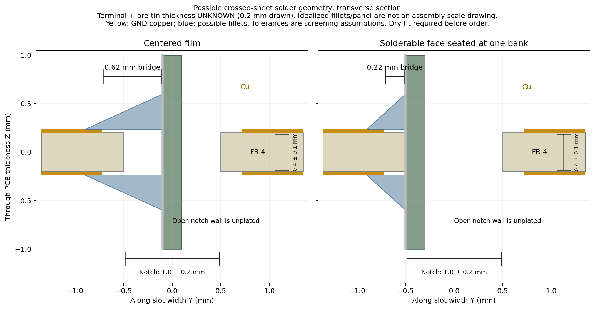

# Open-notch joint: independent assembly review

Reviewed candidate: 0.4 mm PCB, one **unplated open notch** per side, nominal 1.0 mm width along Y × 1.5 mm depth along X, rounded inward end, GND copper on both PCB faces set back 0.22 mm from the route. Panel negative terminal is the structural attachment; an insulated positive lead returns to a lower PTH.

**A physically possible solder-joint geometry exists. It is a crossed-sheet joint, not a flat panel bonded to a PCB pad, and its fit and strength are not established.** The candidate may proceed as provisional CAD. Measure and dry-fit the actual terminal, including pre-tinning, before ordering boards.

## What the reference images establish

I rendered and inspected the [ZachTek assembly PDF](../sources/zachtek-assembly.pdf), pages 2–4. Page 2 instructs pre-tinning both PCB faces. Page 3 prepares a small region at the center of the panel's continuous terminal strip. Page 4 shows the panel plane roughly perpendicular to the PCB plane, with the terminal strip passing through the open side cut. The two visible fillets attach the PCB front and rear faces to one solderable panel face. The images support this topology; they do not supply metrology for the cut, board thickness, solder setback or panel laminate. The pictured terminal is positive; the user's candidate deliberately uses negative.

An open notch admits the middle of a continuous terminal strip from the board side without cutting that strip. A closed plated slot would impose a different threading/tab constraint. No panel cutting is justified or required by this candidate.

## Concrete joint arrangement

Gently seat the panel's **solderable terminal face against one straight notch bank**, with the continuous panel end strip crossing the PCB thickness. Pre-tin the exposed terminal region and accessible GND copper on both PCB faces. Two external fillets can bridge the 0.22 mm nominal copper setback to that same exposed panel face above and below the PCB. The other notch bank need not have a solder joint. This accommodates a terminal that is solderable on only one face.

The routed wall itself is insulating FR-4, not plated copper. Solder does not create a metallurgical bond to that wall or to intact panel polymer. The fillets must wet actual GND copper and actual terminal metal; an unbonded bead filling the notch is not the intended joint. Copper on both PCB faces must be electrically connected in CAD, because an unplated wall provides no barrel connection.

The section deliberately draws a hypothetical 0.2 mm terminal for visibility. Its actual thickness, pre-tinning and fillet shape are unknown. Dimensions 0.4 ± 0.1 mm PCB and 1.0 ± 0.2 mm notch are requested tolerance screens, not a promise of the final fabrication order. Diagram fillets illustrate possible contact geometry, not a prescribed solder volume or proven strength.

### Centering the film creates a different solder gap

For slot width `W`, terminal thickness `t`, copper setback `c`, and a perpendicular panel centered in the notch, the lateral bridge from one exposed panel face to the corresponding PCB copper is:

`g_center = c + (W − t)/2`.

With `W=1.0 mm`, `c=0.22 mm` and an **assumed** `t=0.20 mm`, this is **0.62 mm**, not 0.22 mm. Across `W=0.8–1.2 mm`, it is 0.52–0.72 mm. Seating the solderable face at one bank reduces the near-bank lateral bridge to the copper setback, 0.22 mm nominal. It does not require filling the full 1 mm notch. More setback tolerance or a coating lip can increase the real gap.

This is why “a close-fitting captured slot” would be an unsupported description. The panel can slide out before soldering; the open notch provides alignment and one contact boundary, while the finished bond supplies pull-out retention. Its thin-film terminal and laminate remain part of the structural load path.

### The rounded end reduces usable bank overlap

The nominal 1.5 mm cut depth includes the R0.5 mm rounded tip. A straight rectangular panel end held flush against a notch bank can enter only to the end of the **straight bank**, approximately **1.0 mm**, before a terminal corner encounters the rounded end. It cannot remain flush while entering the full 1.5 mm tip depth. A centered panel can enter farther, but then requires the larger lateral solder bridge above.

With a 0.20 mm setback from the outer PCB edge as well, the nominal available copper overlap along the straight bank is approximately `D − W/2 − c_outer = 1.5 − 0.5 − 0.2 = 0.8 mm`. Holding depth fixed and screening widths 0.8–1.2 mm gives **0.9–0.7 mm**. Actual route-depth error, copper registration, corner shape, coating and panel-end straightness further affect this. The candidate does not provide a 1.5 mm-long bank fillet just because the notch is 1.5 mm deep.

The final layout uses 0.22 mm nominal setback from the notch wall to preserve at least the 0.20 mm design screen after polygon approximation of the rounded tip; the outer board-edge setback remains 0.20 mm. These are separate dimensions.

No verified terminal-strip width or soldered load data was found that justifies increasing or decreasing the notch today. Increasing depth could increase available overlap but also consumes ground-land ligament and clearance; reducing width could reduce solder gap but may violate route capability or pre-tinned fit. Select those changes from the real tab measurements and a mockup, not from the photo scale.

### Panel tilt consumes clearance

For a rigid terminal crossing a PCB of thickness `B` at angle `θ` away from perpendicular, a conservative 2D occupied width through the board is:

`W_required = t/cos(θ) + B·|tan(θ)|`.

At perpendicular entry, the board thickness does not consume slot width. At 45°, a hypothetical 0.2 mm terminal crossing a 0.5 mm board occupies about **0.783 mm**, nearly the whole 0.8 mm minimum screened notch. At 60° it requires about **1.266 mm**, exceeding even the 1.2 mm screened maximum. These are geometry examples, not a claim about the final bend angle. The curved panel should begin its bend outside the joint; do not force a pre-tinned terminal diagonally into the nominal gap or use the routed edge as a sharp bend tool.

## Measurements needed before an order

1. **Terminal thickness at the intended insertion region**, bare and after the proposed coating removal/pre-tinning. Record the maximum local solder bulge, not just untouched polymer thickness.
2. **Which terminal face is solderable**, terminal-strip width along the insertion direction, edge-to-active-cell clearance and the available bare-metal patch size. The ground joint must remain entirely on the negative terminal.
3. **Bare-metal exposure across the PCB thickness.** The cleaned patch must span the finished PCB and leave accessible metal beyond both PCB faces for fillets. A patch only 0.5 mm high cannot provide both external fillets around a 0.5 mm board. Required exposure is `B_max + front_fillet_wetting_height + rear_fillet_wetting_height`; choose those wetting dimensions from the assembly trial rather than assuming them.
4. **Perpendicularity, intended insertion depth and neighboring clearance** with the actual bowed panel, capacitor pouch and iron tip. Verify that the solderable face can reach the selected bank without active cell material contacting the PCB or the polymer peeling at the edge.
5. **A representative coupon joint** with the intended 0.4 mm laminate, edge setback and finish. Inspect both wetting interfaces, test retention and deflection under a chosen measured load, and repeat after handling/thermal cycling before claiming the soldered strip supports the flight assembly.

The exposed copper setback and board-outline tolerance must be checked together in the final fabrication review; a nominal CAD setback is not a measured finished gap. This review makes no request for special edge plating, casts no assumption that a 0.4 mm board has plated notch walls, and does not declare the prototype ready for a 15-board order.

## Reproduction

Run `analysis/.venv/bin/python analysis/v1_1_solar_attachments_20261012/mechanics/notch_fit.py`. It writes the [width/tilt tolerance screen](crossed_sheet_fit.csv), [solder/rounded-tip geometry](notch_solder_geometry.csv), [summary](notch_fit_summary.json) and diagram. Two geometry consistency checks pass. No panel was measured, cut, soldered or mechanically tested; canonical CAD is unchanged by this review.
