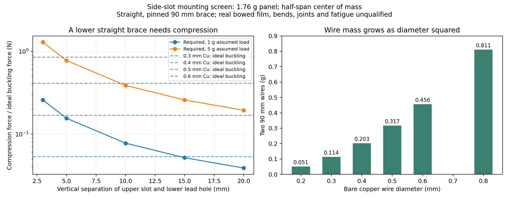

# Side-slot solar mounting: mechanical and RF review

2026-10-12. Independent review of the requested v1.1 arrangement: one structural **GND slot above a separate +SOLAR lead hole on each side**, initially near the present middle connections. This reverses the photographed ZachTek panel polarity orientation, which is electrically possible. The two panel negatives meet GND at the inner edges; their outer positives return independently to the shared +SOLAR input. Both panels remain in parallel.

**Use the direct inner negative joints as structural joints, and treat a flexible positive wire as an electrical lead unless a prototype demonstrates load sharing.** More separation between the upper slot and lower hole makes a rigid brace more useful. A few millimeters of separation and a long fine wire do not reproduce a robust triangular frame merely because the assembly resembles the reference photo. Keep this distinction in the assembly drawing and in any mass claim.

The subsequent [open-notch assembly review](NOTCH_ASSEMBLY.md) checks the proposed 1.0 × 1.5 mm cut on 0.4 mm FR-4. It includes a dimensioned crossed-sheet joint section, tolerance and tilt screens, and the measurements required before ordering. The joint is physically possible but has only about 0.8 mm nominal bank/copper overlap when the panel is seated against one bank; neither fit nor strength is qualified.

## Evidence and dimensions

The archived [ZachTek product page](../sources/zachtek-panel.txt) lists SKU1044 at **1.76 g per panel**, nominal 4.8 V, 50 mA. The manufacturer's [assembly guide](../sources/zachtek-assembly.txt), pages 2–5, describes a center tab on the inner **positive** edge soldered into the top PCB cut, with an approximately **90 mm wire** from the outer negative strip to a lower board pad. It recommends a modest downward slope. The user's new GND-inner arrangement intentionally differs from that polarity orientation.

Neither archived primary source gives verified panel film thickness, terminal-strip thickness, radial span, strip width, allowable solder dwell, bend radius or allowable tab load. The old RF study's 70 mm radial span is a **photo estimate**, not a manufacturer dimension. Film thickness must be measured on the actual panel, including the terminal and pre-tinning where relevant, before declaring a slot width fit for manufacture. Do not size a production slot to the artwork's apparent dimensions.

Changing which end faces the PCB does not itself reverse the illuminated face: rotate each panel in its own plane while keeping the active face outward. Confirm the manufacturer's polarity marking or measured polarity before soldering. Give the two sides mirrored mechanical geometry without interchanging their nets. Keep the positive return insulated or geometrically restrained wherever it could touch the grounded slot, panel negative terminal, exposed rear copper or capacitor terminals.

## Load paths and model limits

The reproducible [model](model.py) writes [root moments](root_moment_screen.csv), [wire properties](wire_properties.csv), [lower brace screens](lower_brace_screen.csv), [unknown-film sensitivity](unknown_film_sensitivity.csv) and [thermal mismatch](thermal_mismatch_sensitivity.csv). All quoted accelerations are scenarios; none is a measured flight load or a qualification target. Material constants are generic copper screening values: density 8.96 g/cm³, elastic modulus 110 GPa, thermal conductivity 400 W/(m·K), CTE 16.5 ppm/K and room-temperature resistivity 1.724×10⁻⁸ Ω·m. Actual wire temper, joints and fatigue are not characterized.

For a uniform-mass panel of horizontal span `x`, a root-only support carries moment `M = m·a·x/2`. A 70 mm span and 1.76 g panel give **0.604 N·mm at 1 g** and **3.02 N·mm at an illustrative 5 g**. This is the demanded joint moment, not a predicted solder strength. If a joint resisted it by two forces separated by 1 mm, each force would be 3.02 N at 5 g; a 2 mm effective separation would halve that to 1.51 N. The actual solder/foil/laminate load distribution is unknown. Do not substitute PCB thickness for this force-couple separation without resolving the joint geometry and load direction.

The thin panel's own bending stiffness cannot be certified from the reference photo. The sensitivity file spans assumed effective modulus 1–5 GPa, thickness 0.1–0.5 mm and width 30–50 mm at a 70 mm span. These are **hypothetical laminate values**, not claims about SKU1044. Many cases violate small-deflection beam theory even at 1 g. Real curved film can carry membrane forces; it can also wrinkle, rotate or locally peel. Neither a straight-film beam model nor a rigid-panel model qualifies the finished bowed assembly.

### Why the lower wire is not automatically a tension support

For a deliberately simple 2D model, set the direct root joint at `O=(0,0)`, the lower PCB anchor at `B=(0,−s)`, and the panel outer end at `P=(x,−h)`. The brace length is `L=√(x²+(h−s)²)`. Replace the direct joint with an ideal pin to isolate brace action, and place downward panel load `F` at horizontal distance `x/2`. Taking moments about the root gives:

`C·x·s/L = F·x/2`, therefore **`C = F·L/(2s)` in compression**.

Tension in this lower brace produces a moment in the same direction as the downward load. A tensile tie to an anchor **above** the root would provide the opposite moment. The real reference assembly has a curved film and soldered joints rather than these ideal pins, so it can stabilize its curvature through other load paths. The result means only that a lower flexible lead cannot be credited as a tensile support that removes root bending under weight. Under load reversal, the signs reverse.

For a 90 mm brace and a uniform panel:

| Upper/lower anchor spacing | Compression needed at 1 g | At illustrative 5 g |
|---|---:|---:|
| 3 mm | 0.259 N | 1.294 N |
| 5 mm | 0.155 N | 0.777 N |
| 10 mm | 0.0777 N | 0.388 N |
| 15 mm | 0.0518 N | 0.259 N |
| 20 mm | 0.0388 N | 0.194 N |

For a perfectly straight round copper wire with pin ends, the ideal Euler load is `Pcr = π²EI/L²`, where `I=πd⁴/64`. A bent or initially bowed lead is not this ideal column. Soldered ends may provide rotational restraint, while bends, initial curvature, eccentric joints and copper yielding alter the result. **The values below are a boundary-condition screen, not an allowable-load table or safety factor.**

| Copper diameter | Two bare 90 mm wires | Ideal pinned buckling load, each | Positive-lead drop at 50 mA |
|---|---:|---:|---:|
| 0.2 mm | 0.051 g | 0.0105 N | 2.47 mV |
| 0.3 mm | 0.114 g | 0.0533 N | 1.10 mV |
| 0.4 mm | 0.203 g | 0.168 N | 0.62 mV |
| 0.5 mm | 0.317 g | 0.411 N | 0.40 mV |
| 0.6 mm | 0.456 g | 0.853 N | 0.27 mV |
| 0.8 mm | 0.811 g | 2.695 N | 0.15 mV |

Electrical resistance readily permits fine positive wires. Mechanical support is what may require more material. At 5 mm separation, a 0.4 mm straight brace is already marginal in the ideal 1 g screen; at 15 mm the ideal force demand is one third as large. A 0.5 mm wire pair adds only 0.114 g over a 0.4 mm pair, whereas going to 0.8 mm adds 0.608 g. Reducing unsupported length and improving the attachment geometry can avoid that mass increase. Solder, enamel/insulation, wire bends and strain relief are additional mass, not included above.

## Slot, board and assembly implications

Use a rounded slot end and enough laminate surrounding the opening; a sharp cut and narrow remaining ligament concentrate stress. Copper on both faces improves solder access and can distribute load, but it does not establish the peel strength of a thin laminate or fragile PV metallization. The benefit of any slot barrel plating depends on the actual fabrication method; an edge-open cut, closed plated slot and routed non-plated notch are different manufacturing features. Fabrication approval must match the exported feature rather than the visual intent in KiCad.

No assembly paste aperture is required on these hand-soldered joints. Keep clear access to both faces for the iron and an inspectable fillet, including the actual panel and the capacitor on the rear. Check the capacitor pouch and pressure sensor vent in the assembled geometry, not only the bare PCB footprint. Leave compliant length between the wire's solder fillet and its first sharp constraint. A small, weighed strain-relief feature may be lighter than replacing a flexible lead with a thick structural wire. A slot that merely admits the tab still needs a demonstrated retention path; “less tape” is a useful goal, but solder volume alone is not a mechanical validation.

Moving the attachments near the top could increase their distance from the LoRa feed, change the suspension moment, and make a larger upper/lower anchor separation easier, but it also places panel conductors near the GNSS antenna. Those are new assembled-geometry variables. For v1.1, retaining the current broad board outline and middle location bounds the change. A shorter and thicker board needs a component-relayout and balance study; equal FR-4 mass does not imply equal bending stiffness or equal solder-joint stress.

## Temperature, altitude and RF

The ideal thermal conductance of two 90 mm copper leads is **1.12 mW/K at 0.4 mm** or **1.75 mW/K at 0.5 mm**, excluding contact resistance and radiation along the wire. With an imposed 20 K panel–PCB difference these paths carry about 22 or 35 mW. Directly soldering the inner panel terminal adds another heat path whose cross-section and construction are unknown. This can change measured board temperature; the model does not claim ambient-air temperature accuracy.

A 90 mm copper wire contracts by about **119 µm over an 80 K drop**. For a hypothetical 70 mm panel span and effective panel CTE between 5 and 100 ppm/K, its free contraction differs from copper by about **20–468 µm over 80 K** across the chosen scenarios. Film layup and CTE are not provided, so thermal stress or fatigue cannot be calculated reliably. A compliant lead loop reduces restraint, at the cost of forfeiting its assumed straight-column support. The structural root joint and lead must be tested as that actual assembly. Low pressure does not eliminate handling, rotation, launch transients or thermal cycles; lower air density changes both aerodynamic load and damping. Balloon speed over the ground is not relative airflow and cannot be inserted as a wind load.

At 915 MHz, a 90 mm conductor is about **0.275 free-space wavelengths**; at 434 MHz it is about **0.130 wavelengths**. A grounded inner terminal and a long positive lead change the counterpoise/current paths. A power-input capacitor is not automatically a low-impedance RF ground at these frequencies: package inductance, self-resonance and layout matter.

Optional prior local evidence: the repository's [old RF study](../../antenna/09_solar_partF.md) predicted a large change in the untuned impedance when the panel ground moved from the far to near edge. Its tuned results differed by less than about 0.7 dB. The later [numerical audit](../../redesign_20261010/radio_mechanics/README.md#what-the-old-solar-nec-model-can-and-cannot-settle) showed that refining the long far-edge wire segmentation did not remove that sensitivity, but the model still uses lossless coplanar grids, estimated dimensions and no measured PV input-network RF behavior. The original blanket “do not swap” conclusion is stronger than the available evidence. This new mounting is a reasonable experiment; **neither an RF improvement nor preservation of the previous antenna tune has been demonstrated**.

Compare the full existing and new assemblies using the same panels, wire lengths and harness: antenna impedance and repeatable radio link margin across the intended high-band channels, GNSS C/N₀ and acquisition while transmitting, and pair output while rotating. Retune the antenna for the final assembly. A VNA match alone does not measure radiation efficiency. Do not use the old model's optimum antenna lengths as production cut dimensions.

## Minimum prototype evidence

1. Measure both actual panel terminals: strip/film thickness, available solderable width, assembled span, panel mass and bend shape. Dry-fit the intended slot with the chosen PCB thickness and solder process.
2. Weigh the finished root joints, positive wires and any retained strain relief. Compare complete assemblies, including solder and tape.
3. Measure root deflection and inspect the foil/fillets under a controlled load in both directions, then repeat after handling and thermal cycles. Derive the load target from the intended handling/launch envelope; the 5 g screen above is not an acceptance specification.
4. Inspect for contact with the cap pouch/terminals, sensor lid/vent and antenna conductors throughout the observed flex range. Verify solar polarity and input operation after the mechanical checks.
5. Compare RF/GNSS and power performance on the complete geometry before ordering the larger batch.

The panel and assembly-guide captures needed for source provenance are included in this study’s `sources/` directory. The two older RF-study files are optional background provenance: the model records their presence and hashes when available, and continues if they are absent. Their availability does not affect any mechanics calculation.

Reproduction: `analysis/.venv/bin/python analysis/v1_1_solar_attachments_20261012/mechanics/model.py`. Five algebra/units consistency checks pass, including a direct vector-moment check for the lower-brace sign. The generated chart was visually inspected. No mechanical, thermal, RF or flight measurements were performed, and this review changes no canonical CAD files.
