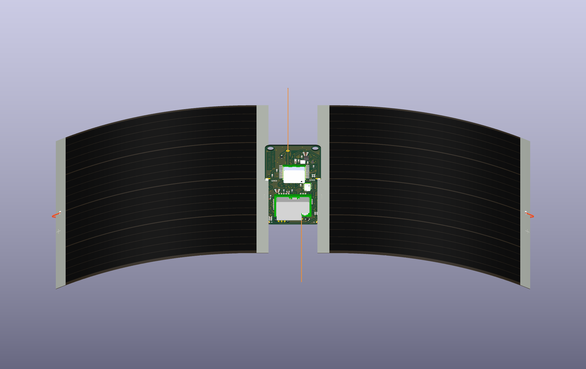

# Photo-scaled solar mounting revision

2026-10-12 · canonical project: `hardware/pcb` · branch: `alpha/hardware-v1.1` · baseline: `76ee6e8`.

The mounting geometry is now specific enough to build a representative v1.1 prototype: **94 × 75 mm panels, 1 × 2 mm open notches, both-face ground fillets and central 0.5 mm solid positive leads**. It preserves the 0.4 mm board, its outside dimensions, all 57 other components and every existing signal route. The first assembly must still establish the terminal's fit and strength; the website photograph cannot reveal solder heat damage or foil adhesion.

## Dimensions and design choices

| Item | Selected geometry | Basis |
| --- | --- | --- |
| Panel developed span × width | 94 × 75 mm | ZachTek metric-grid photo; conservative image uncertainty ±2 × ±1.5 mm |
| Visible terminal strip | 5 mm nominal | Approximately 4–6.5 mm across ambiguous image boundaries; not a wettable-area specification |
| Notch width × depth | 1.0 × 2.0 mm, R0.5 tip | Native PCB geometry; ordinary open unplated routing |
| Root insertion | 1.5 mm nominal | End of straight bank before rounded tip; set from actual manufactured bank |
| GND solderable overlap | 1.3 mm nominal | 1.5 mm straight bank minus 0.2 mm outside-edge copper setback |
| GND land | 2.1 × 0.68 mm on each PCB face | Upper bank only; one existing 0.3 mm drill GND via per side |
| Notch-wall copper setback | 0.22 mm nominal | Solder bridges to exposed copper; routed FR4 wall is unplated |
| Positive hole/land | 0.7 / 1.4 mm | Existing lower pad retained |
| Positive conductor | 0.5 mm solid copper | Lower sensitivity to bow than 0.4 mm; adequate hole clearance before wire/tin tolerance |
| Straight root / curved section | 7 mm / R140 mm | Chosen assembly shape; keeps visible terminal strip unbent |
| Film thickness in rendering | 0.20 mm | Display assumption, not determined from photograph |

The photo is from [ZachTek SKU 1044](https://www.zachtek.com/product-page/copy-of-solar-cell-for-pico-balloons-polymer-4-8v-50ma). [Calibration, selected points, source hash and uncertainty](metrology/README.md) make the image measurement reproducible. The previous 71 × 40 mm illustration was undersized and is superseded. The product lists 1.76 g per panel. We did not establish an underlying manufacturer identity or import another manufacturer's film thickness into this design.

## Why this notch

Deepening by 0.5 mm raises available straight copper overlap from 0.8 to 1.3 mm, a **62.5% increase in length**. This provides more length for the solder fillet but is not a measured strength increase. A deeper cut through the old U-shaped pad would leave an inadequate copper bridge. Splitting that pad into upper and lower banks isolated the lower banks after native refill. The accepted design keeps the upper bank, where the exposed panel terminal actually seats, with its existing GND via and front/back copper. Both physical faces retain full GND connectivity. Removing the unused lower banks/vias avoids signal rerouting.

The [layout study](layout/README.md) compares deeper cuts, checks minimum clearances, and records the rejected isolated-bank candidate separately from the accepted one. At the published ±0.2 mm slot-width screen, the 2 mm depth gives approximately 1.2–1.4 mm available bank overlap before depth/registration errors. The joint is seated against one bank, so it does not depend on filling a large central slot gap with solder. The 1 mm nominal route is at the recorded JLC minimum; do not narrow it to match a thin film.

## Assembly

1. Check the delivered panels' polarity and prepare a small solderable patch at the center of each inner **negative** strip, following ZachTek's preparation guidance. Inspect for lifted foil or damaged film. Measure prepared thickness including tinning; the overhead photo cannot provide it.
2. Seat the exposed negative face against the **upper straight notch bank**, approximately 1.5 mm in. Keep the entire terminal strip straight; support the broad panel in a jig while soldering. Use the actual routed straight bank as the depth reference instead of forcing the terminal into the rounded tip.
3. Make accessible fillets between that same terminal face and the **GND copper on both PCB faces**. The model shows 1.2 mm-long fillets within the nominal 1.3 mm overlap. Solder must wet metal on both parts; the notch wall is bare FR4.
4. Form each panel's gentle downward curve outside the 7 mm straight root. The R140 curve is a chosen shape, not a published minimum radius. Keep pressure off the active film and verify clearance as it flexes.
5. Attach a **central 0.5 mm solid positive lead** to the outer positive strip. Follow its exposed face past the free edge, then turn underneath with a smooth short hook that clears the film. Keep the long return straight and insulated where incidental contact is possible. Form a short entry bend and pass a bare, untinned tail into the corresponding lower +SOLAR hole before soldering. Both panels remain parallel.

The displayed wire centerlines are approximately 95.8 mm including formed ends, not production cutting lengths. They contain about 0.337 g of copper per pair, excluding insulation and solder. The longer straight segments are about 87.6 mm. The [rear view](views/assembled-rear.png) shows their route; the [root close-up](views/ground-joint-detail.png) shows the seated terminal and fillet.

## Mechanical evidence and remaining physical check

The [mechanical model](mechanics/README.md) uses the listed 1.76 g panel mass and the chosen curved shape to calculate root demand, ideal compressive brace demand, wire bow and thermal length sensitivity. It evaluates an illustrative 5 g case and separate handling loads. It assigns no invented terminal peel strength, solder-joint allowable or wire yield strength. A straight wire must carry **compression** to help support the panel; a slack loop cannot be credited as the same brace. Formed ends and film flexibility reduce the value of an ideal column calculation.

For the first assembly, record prepared thickness, actual insertion/wetted length, fit, complete mass and solar output. Apply controlled, distributed bidirectional loads with a broad cradle; record force, lever arm, deflection and residual deformation, then inspect foil and both solder joints. Repeat continuity/output and clearance checks after temperature cycling over the intended payload range. The model includes a suggested 5 g screen, not a released load rating. Check assembled RF/GNSS behavior because the larger grounded panel envelope and leads alter the antenna environment.

## Verification

- 57 other footprints, 879 straight tracks and 3 track arcs are byte-for-byte equivalent as parsed objects; 142 remaining vias are unchanged. Only two unused lower GND vias were removed.
- All **230 physical-pad connectivity comparisons pass**; each solar GND land on each face reaches all 67 original logical GND nodes. Schematic electrical objects and net assignments are unchanged; only the two solar footprint names changed.
- Native project DRC: **70 inherited findings, 0 unconnected, 11 inherited parity findings**. Enabled diagnostic screen: **83, 0, 11**. No new finding signatures. Fresh canonical DRC agrees.
- Fresh manufacturing review exports confirm open **1 × 2 mm** notches with **R0.5**, ordinary PTH positive holes/vias, no solder paste at manual contacts, and no plated slot assumption. The review archive is not an order release.
- Portable model references remain on J1/J2 and their renamed reusable footprints. Native KiCad renders show the revised assembled geometry.

[Scope/connectivity/DRC evidence](layout/upper-only-verification.json) · [Canonical promotion hashes](promotion.json) · [Fresh canonical DRC](drc-canonical.json) · [Manufacturing review exports](layout/fabrication/review-exports.zip) · [3D regeneration](../../../hardware/pcb/3d/solar/README.md).

[Independent 3D geometry review](model-review.md) · [Final canonical scope/hash check](final-verification.json).

The pre-existing whole-board fabrication findings remain in [the hardware checklist](../../../hardware/pcb/TODO.md). This change closes the CAD refinement and source-based dimension work; physical joint validation belongs to the first pilot.
