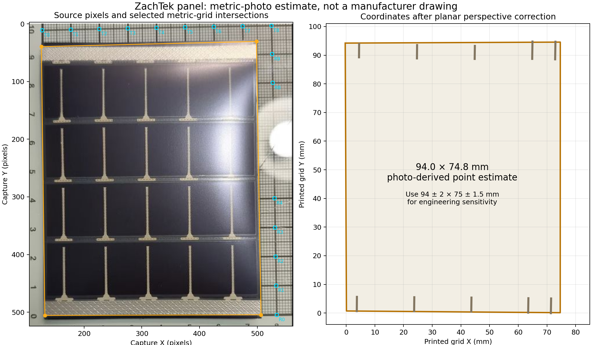

# ZachTek panel photo metrology

The primary product photograph supports an approximately **94 × 75 mm** panel, measured from terminal end to terminal end and across the panel. Use **94 ± 2 × 75 ± 1.5 mm** for engineering sensitivity. The terminal metal strip is nominally about **5 mm** wide; a conservative photo-only range is **4–6.5 mm**. These are image-derived assumptions, not manufacturer specifications or production tolerances.

The lower terminal provides the clearest width measurement: five stations give **4.84–5.13 mm**. The upper band gives **4.54–6.14 mm**, with visible glare, a raised edge, and uncertain shadow boundaries. Neither terminal thickness nor the bare solderable patch after scraping can be determined from this view.



## Source and calibration

Source: the parent task's in-app-browser capture of ZachTek's primary product photograph, [`../sources/zachtek-metric-photo-browser.png`](../sources/zachtek-metric-photo-browser.png), 1280 × 1102 pixels.

SHA-256: `5b9faad0a61e231a8d753d6bc7bd92a68e95286597f6a25dba17d9f12d62dba3`.

Coordinates below refer to the full capture: origin at its top-left, X right, Y down. The relevant photo occupies the upper-left area, not the full black-backed screenshot. The printed metric grid has 10 mm major spacing. Sixteen visible intersections were selected along the top 100 mm grid line and the right 80 mm grid line. Local grayscale minima refine the point picks; the script preserves the search windows and the resulting subpixel coordinates.

A planar projective transform fits those intersections with **0.148 pixel RMS per coordinate**, approximately 0.03 mm at the local scale of about 5 pixels/mm. This is a grid-fit residual, not physical panel accuracy. The complete forward/inverse matrices, pixel picks, residuals, and per-station measurements are in [`measurement.json`](measurement.json).

Selected physical panel boundaries exclude the dark shadow beneath the lower terminal:

| Corner | Capture X, Y (pixels) | Calibrated X, Y (mm), approximately |
|---|---|---|
| Upper left | 126.0, 39.5 | −0.36, 94.23 |
| Upper right | 498.5, 30.5 | 74.66, 94.57 |
| Lower right | 506.5, 504.5 | 74.64, 0.11 |
| Lower left | 132.0, 505.5 | 0.08, 0.71 |

The resulting opposite lengths are 93.52 and 94.46 mm; opposite widths are 75.02 and 74.56 mm. Their means are 93.99 × 74.79 mm. The disagreement between opposite sides is evidence of photo/edge/nonplanarity uncertainty, not a claim that the manufactured panel is trapezoidal.

## Uncertainty and what the photograph cannot establish

A reproducible 2,000-trial coordinate-picking sensitivity sweep perturbs grid points by ±0.75 pixel and panel corners by ±2 pixels. Its central 95% ranges are 93.44–94.57 mm for mean length and 74.26–75.33 mm for mean width. A simpler affine calibration gives 93.76 × 75.19 mm. These calculations support rounding to 94 × 75 mm, but do not include the dominant physical limitations below.

- The printed grid is planar; the upper panel edge is visibly raised/curling. A homography cannot correct an object above that plane.
- The dark lower shadow and upper glare obscure exact boundaries. Including a shadow as physical material changes apparent length by roughly 1–2 mm.
- The photograph does not certify the grid's printing accuracy, lens distortion, manufacturing dimensions, or panel tolerances.
- The patterned metal band is not a measurement of exposed wettable copper after the coating is scraped. It supplies no peel strength or solder-joint allowable.
- Film thickness, conductor thickness, coating thickness, minimum bend radius, and finished joint strength remain unknown.

The wider recommended engineering ranges (92–96 mm length, 73.5–76.5 mm width, 4–6.5 mm terminal strip) deliberately include more uncertainty than coordinate picking alone. They are assumptions to stress-test a design. They are not manufacturer tolerances or statistically established confidence intervals.

`top_detail.png` and `bottom_detail.png` retain pixel axes and expose the specific shadow/glare ambiguity behind the strip-width range. They are useful audit views, not modified product photographs or dimensional drawings.

Reproduce from repository root:

```sh
analysis/.venv/bin/python analysis/v1_1_solar_attachments_20261012/qualification/metrology/measure.py
```

The script verifies the capture hash and writes only this metrology directory. Its point selections must be reviewed if the source image changes.
