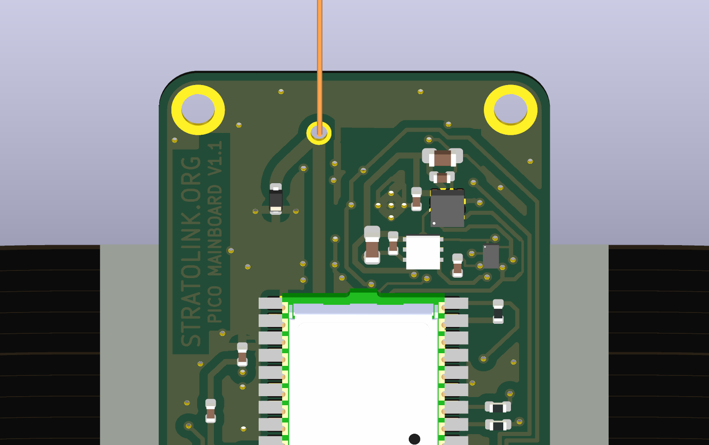

# v1.1 suspension corners

2026-10-12 · original board `a9d6ed5` · canonical working project `hardware/pcb`

**Implemented: two 2.0 mm plated suspension holes with 3.2 mm ground rings, at the original centers.** This is a small geometry improvement for Teddy's thin stretchy-string triangular bridle. The 0.4 mm stackup, board outline, solar attachments, all existing component placements and all existing routes remain unchanged.

The original openings were **2.701 mm unplated circular profile cutouts**, leaving about **0.997 mm** of laminate around the rounded corners. A 2.0 mm finished hole leaves 1.348 mm to the finished bore; allowing a nominal 18 µm plated wall gives about **1.330 mm of FR4 ligament**, roughly **33% more material width**. That is a dimensional comparison, not a measured strength improvement. The plated rim avoids leaving a bare drilled FR4 wall, but rim finish, wear, fatigue and adhesion remain untested.

The native filled-copper mass comparison estimates **about 13 mg added bare-board mass**, including copper that refills beyond the pad rings. It uses explicit density and barrel-thickness assumptions; finish and solder are excluded. [Full mass delta](layout/mass-delta.json).

Moving the right hole inward/downward would crowd the existing solar supply route: a 0.3 mm shift in each direction with this ring leaves only 0.148 mm clearance. Keeping centers avoids that reroute. Enlarging the entire board or changing thickness is unnecessary for this iteration.

## What the modeling established

Teddy threads one continuous string through both holes and ties the apex to the balloon. The bottom segment of that triangle can add substantial inward force at each corner. The analytical screen includes this topology, independently tied legs, different apex heights, uneven loading, shock multipliers, thin-line bearing and out-of-plane misalignment. Stretch can soften a taut system's shock, but slack take-up and knots prevent assuming a known peak load from “stretchy” alone.

The native-outline membrane finite-element comparison predicts a modest, conditional stiffness benefit from the smaller hole. It **does not predict reduced stress everywhere**: narrower contact cases raise the selected hole's local band-stress indicator by 8–9%. The design choice favors more remaining laminate, plated handling surfaces and minimal routing disturbance, subject to the actual-string pilot comparison. There is no evidence here that v1 was about to break, and no fabricated breaking-load claim.

- [Exact geometry, placement alternatives and native verification](layout/README.md)
- [Analytical triangular-bridle, bearing and bending screens](mechanics/README.md)
- [Finite-element method, convergence and contact sensitivity](fem/README.md)
- [Independent mechanics/FE review](mechanics/independent-review.md)
- [Independent manufacturing-export review](layout/fabrication/independent-review.md)
- [Primary supplier/material sources and their limits](sources/README.md)

## Electrical and fabrication verification

H1/H2 are board-only footprints, excluded from BOM and placement. Each uses an ordinary plated round drill, 0.6 mm nominal copper annulus, both-face mask opening, solid ground connection and **no paste**. The project-local footprint is `lib:Suspension_PTH_D2p0_OD3p2`. They require no schematic symbols.

All **59 existing footprints, 879 straight tracks, 3 arcs and 142 vias** retain their parsed geometry. All **230 existing physical pad connections** are preserved. Each new hole pad reaches all 67 original ground nodes. Native project DRC remains **70 findings / 0 opens / 11 parity findings**; the enabled diagnostic remains **83 / 0 / 11**, with identical finding signatures. These are inherited findings, not a clean-board claim.

Actual exports place both 2.0 mm holes in PTH Excellon, remove the former circular profile cutouts, retain the three unrelated lower NPTH holes, and show both new copper/mask rings without paste. [Recorded candidate verification](layout/verification.json), [fresh canonical DRC](drc-canonical.json), [promotion manifest](promotion.json).

## First physical assembly

Measure and record actual string diameter/material, triangle height, knots, assembled payload mass and board thickness. Confirm comfortable threading through both 2.0 mm holes without scraping or forcing a knot through them. Keep the bridle centered and avoid making its apex unnecessarily shallow; do not assume the knot is frictionless.

Use sacrificial v1 and v1.1 samples with the **same actual string and measured load history**. Inspect corner deflection, cracks, plating edges, line fuzzing and creep after static loading, repeated flex/handling and representative cold cycles. Test off-plane and uneven corner loading separately. The mechanics record suggests load increments for comparison, not a certified proof standard or permission to overload the flight article. Check installed RF/GNSS because the top-corner ground geometry changes slightly.

The PCB render shows the new holes and existing solar assembly; it does not model the user's unmeasured string. This is a prototype revision, not a manufacturing release. The next CAD item is U7's overlapping solder-mask apertures, tracked separately.

## Reproduction

Native KiCad 10 scripts under `layout/` build and check a disposable candidate pinned to `a9d6ed5`. Their scratch destination is `~/Repositories/ai-working/scratch/stratolink-suspension-pth`; they do not modify canonical CAD. Mechanics and FE reproduction commands are in their linked READMEs. The checked candidate was promoted byte-for-byte to the actual project, with the schematic and project settings unchanged. The manifest protects all 100 unrelated tracked dirty files from this turn.
