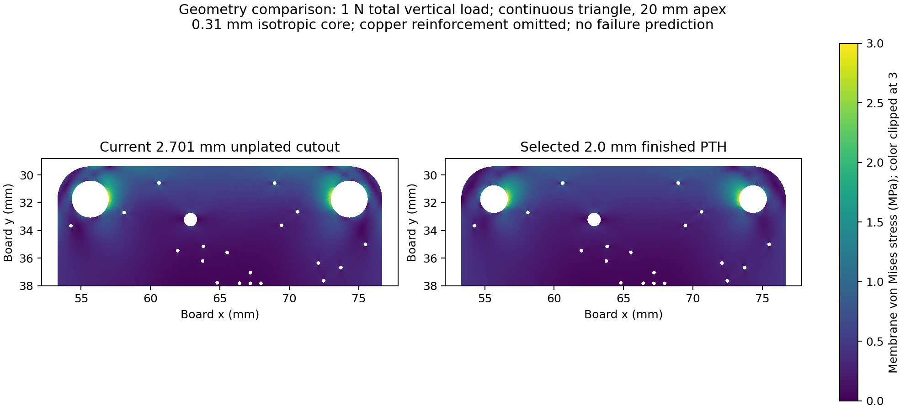

# Comparative upper-corner membrane simulation

The smaller hole gives a **modest reduction in generalized compliance** in this deliberately limited model. It does not establish a breaking load, prove the original corner inadequate, or prove that plating prevents string damage.



`extract_native.py` reads the frozen `a9d6ed5` board through KiCad's native polygon and drill APIs. `model.py` uses constant-strain triangular elements, linear isotropic plane stress, E = 20 GPa, Poisson ratio 0.17, and the actual nominal **0.31 mm FR4 core** inside the 0.4 mm finished board. The material constants are sensitivity assumptions, not certified properties of this laminate. The original upper outline and contained drill holes are retained. Copper, barrels, solder, components and anisotropic laminate failure are excluded.

The lower edge of the truncated model is fixed at Y = 42 mm; Y = 40 and 46 mm are sensitivity cases. Tiny drills intersecting that artificial boundary are omitted, as are centers at/beyond it. Other drill radii are finished CAD sizes, not compensated substrate drilling sizes. The original suspension holes have native radius 1.35050694 mm. Selected suspension substrate radius is 1.018 mm, using a nominal 18 µm plating allowance around a 2.0 mm finished hole; the actual fabricator's compensation is unmeasured.

A continuous triangle with a 20 mm apex height is loaded to **1 N total upward force**. Each hole receives 0.5 N upward and 0.785 N inward, including the triangle's bottom segment. A distributed radial load on a ±60° arc supplies each resultant. This is a smooth loading surrogate, not a thin-string contact solution. Equal ±20° arcs and equal 0.6 mm total arc lengths test narrower contact assumptions. A larger hole has a longer loaded arc under equal-angle loading, so that case alone would be an incomplete comparison.

| Comparison | Selected / original generalized compliance |
| --- | ---: |
| Main case, 0.22 / 0.15 / 0.10 mm meshes | 0.9302 / 0.9285 / 0.9280 |
| Cut at Y = 40 / 46 mm | 0.9210 / 0.9356 |
| Apex height 10 / 80 mm | 0.9738 / 0.8860 |
| Narrow ±20° contact | 0.9609 |
| Equal 0.6 mm contact arc length | 0.9148 |

Generalized compliance here is force-work divided by the square of the total vertical load, and includes inward displacement work. It is **not vertical sag**. Main-case absolute values are 0.0007485 and 0.0006946 mm/N. The last mesh step changes the ratio by approximately 0.055% and either absolute value by less than 0.5%.

The area-weighted von Mises indicator in the band 0.2–0.8 mm from the bore is about **1% higher** in the selected main case, and **8–9% higher** with narrower contacts. The compared bands also have different areas. Neither the colored plot nor the wider ligament supports a blanket claim that stress is reduced. Von Mises stress is displayed as a scalar comparison only, not an FR4 failure criterion. Local tear-out, line bearing, bending, fatigue and abrasion require the separate analytical screen and physical coupons.

Every solve checks mesh-area agreement within 0.1%, nodal force balance, total moment balance, free-node residuals, work/strain energy consistency and an affine displacement patch test. [Numerical results](results.csv), [summary](summary.json), and [independent review](../mechanics/independent-review.md) preserve the qualifications.

Reproduce from the repository root:

```sh
/Applications/KiCad/KiCad.app/Contents/Frameworks/Python.framework/Versions/3.9/bin/python3.9 analysis/v1_1_suspension_20261012/fem/extract_native.py
analysis/.venv/bin/python analysis/v1_1_suspension_20261012/fem/model.py
```

The latter uses the existing NumPy, SciPy, Shapely and Matplotlib analysis environment. Source input is frozen in `input.json`; scripts do not edit CAD.
