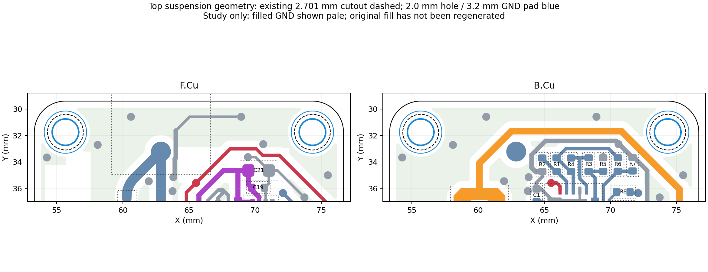

# Suspension-hole geometry and candidate

2026-10-12 · baseline `a9d6ed5` · read-only canonical audit and disposable candidate.

**Keep both centers and reduce the finished hole to 2.0 mm, with a 3.2 mm grounded plated pad.** This adds FR4 around the string opening and puts copper around its wall while preserving every existing route and component. A 2.2 mm hole is also geometrically feasible if the actual line or threading process needs more clearance. The mechanical screen and physical string fit determine whether either is suitable; plated copper is not a guarantee against line abrasion.

## Existing geometry

| Feature | Left | Right |
| --- | --- | --- |
| Center, mm | (55.665, 31.745) | (74.327, 31.745) |
| Opening | Circular Edge.Cuts cutout, not a plated drill pad | Same |
| Exact native radius / diameter | 1.350507 / 2.701014 mm | Same |
| Outer corner radius | 2.348 mm, concentric with hole | Same |
| Minimum FR4 ligament | 0.997493 mm | Same |
| Nearest discrete copper to hole wall | 0.726 mm, GND stitching via | 0.822 mm, B.Cu +SOLAR track |

Hole spacing is 18.662 mm. The top edge is Y = 29.397 mm. The current hole wall has no plated barrel; a copper-colored ring on the surface would not change that manufacturing fact. Existing filled GND stops about 0.5005 mm from each cutout wall. The whole-board GND zone boundaries cover both centers, so replacing cutouts with grounded pads lets native refill join the rings without adding signal routes.

The front antenna feed is AE2, with its pad at (62.882, 33.218) mm. The left hole is about 7.37 mm from that pad center; its proposed ring is 1.872 mm clear of the antenna footprint courtyard. The right ring is 1.059 mm clear of the R7 courtyard. Neither overlaps a rule-area boundary. Grounding the pads changes the local RF conductor shape slightly; geometric clearance does not establish antenna performance.

## Diameter and position comparison

| Same-center option | Minimum FR4 ligament | Annulus with 3.2 mm OD | Comment |
| --- | ---: | ---: | --- |
| Current 2.701 mm opening | 0.9975 mm | 0.2495 mm | Existing opening is unplated |
| 2.2 mm finished PTH | 1.248 mm | 0.500 mm | About 25.1% wider minimum FR4 ligament |
| 2.0 mm finished PTH | 1.348 mm | 0.600 mm | About 35.1% wider minimum FR4 ligament |

These percentages compare widths, not demonstrated assembly strength. Both proposed same-center rings are 0.748 mm from the exterior corner. For the existing 2.701 mm hole, a 2.5 mm OD ring is impossible; 3.0 and 3.5 mm OD give only 0.1495 and 0.3995 mm nominal annuli respectively. Those numbers describe a plated annulus. An unplated routed opening would additionally require copper setback from its wall, so one cannot equate a surface ring with barrel plating.

Relocating inward alone does not improve the upward ligament, and moving downward alone does not improve the outward side ligament. For inward shift `dx` and downward shift `dy`, nominal top ligament is `2.348 + dy − r`, side ligament is `2.348 + dx − r`, and their minimum controls over the nearby straight edges. The rounded-corner arc has no smaller distance for the screened shifts. [screen.csv](screen.csv) and [screen.json](screen.json) retain 0.3, 0.5 and 1.0 mm shifts separately by axis and diagonally.

The right +SOLAR diagonal is the limiting routing obstacle. With a 3.2 mm grounded ring at the current center, non-GND copper clearance is 0.573 mm. Moving that ring both inward and downward by 0.3 mm reduces clearance to 0.148 mm, below the 0.15 mm diagnostic screen; 0.5 mm overlaps the track by approximately 0.135 mm. The left ring has ample room, but asymmetric relocation offers no useful minimal-change advantage here. Reduced bare NPTH holes at the current centers are also clear; their exposed FR4 walls remain an abrasion consideration.

## Disposable candidate and validation

Candidate: `/Users/twarn/Repositories/ai-working/scratch/stratolink-suspension-pth/candidate/stratolink.kicad_pcb`.

PCB SHA-256: `82926d9dfc728dca41c9d0970c69a5144fb9079380a298337381c199698f80f4`.

The candidate removes only the two circular Edge.Cuts items and adds H1/H2, each using `lib:Suspension_PTH_D2p0_OD3p2`. These are board-only mechanical footprints, excluded from BOM and placement, with a 2.0 mm PTH, 3.2 mm round pad, solid GND connection on both faces and no paste. Their local library is under the candidate's `lib/` folder. They need no schematic symbols; schematic and project bytes are unchanged. The outer outline, solar notches, solar assembly models, every existing footprint and every existing track/via remain exact.

The [complete native geometry mass comparison](mass-delta.md) gives approximately **13.1 mg added bare-board mass** under the stated stackup/density/plating assumptions. This includes 3.45 mg of added ground-fill copper outside the two pad discs; a ring-only subtotal is not the total board delta.

Native verification records:

- All 59 existing footprints, 879 straight tracks, 3 track arcs and 142 vias are unchanged as parsed objects.
- All 230 existing physical pads retain their original logical connectivity after excluding the two newly added mechanical nodes. Each H1/H2 pad reaches all 67 original GND nodes; the connected ground set now contains 69 nodes.
- Native opens: 0. Project DRC: 70 → 70. Enabled diagnostic DRC: 83 → 83. Schematic parity: 11 → 11. **No added or removed finding signatures.**
- The board profile remains valid and its outside dimensions are identical. Its internal routed cutouts change from two to zero; the new openings are in the plated drill layer. KiCad outline area alone therefore includes the new drill locations and must not be used directly as physical laminate area.
- Independent fabrication review passes: both 2.0 mm holes appear in the PTH file at their correct centers; all three existing 0.991 mm bottom NPTH holes remain. Actual Gerbers contain the 3.2 mm H1/H2 flashes on both copper and mask faces, no paste, and no old circular profile cutouts. The exporter and independent reviewer left the candidate unchanged.

[Full verification](verification.json) · [native project DRC](drc-project.json) · [diagnostic DRC](drc-diagnostic.json) · [candidate builder](build_scratch.py) · [scope/connectivity checker](check_candidate.py).

[Independent fabrication review](fabrication/independent-review.md) · [export evidence](fabrication/export-evidence.json). Exports are review artifacts, not a manufacturing order release.

`extract_native.py` and `screen.py` reproduce the geometry audit. Polygon copper envelopes use a maximum 0.001 mm outward approximation error. Reported exact corner ligaments use the analytical 2.348 mm circle; KiCad's default outline polygon approximation is approximately 0.003 mm smaller at the concentric center. Native DRC and physical-pad reachability verify the implemented candidate separately from this initial envelope screen. No canonical CAD was changed by this work.
