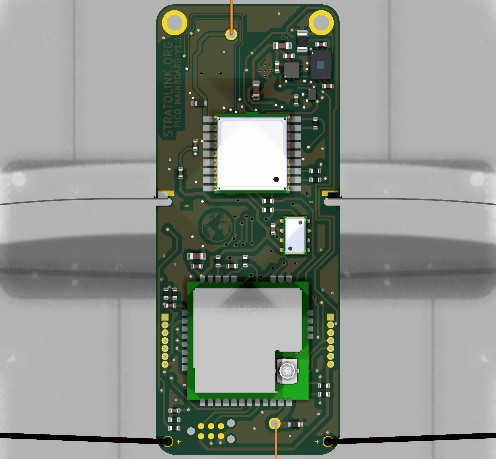
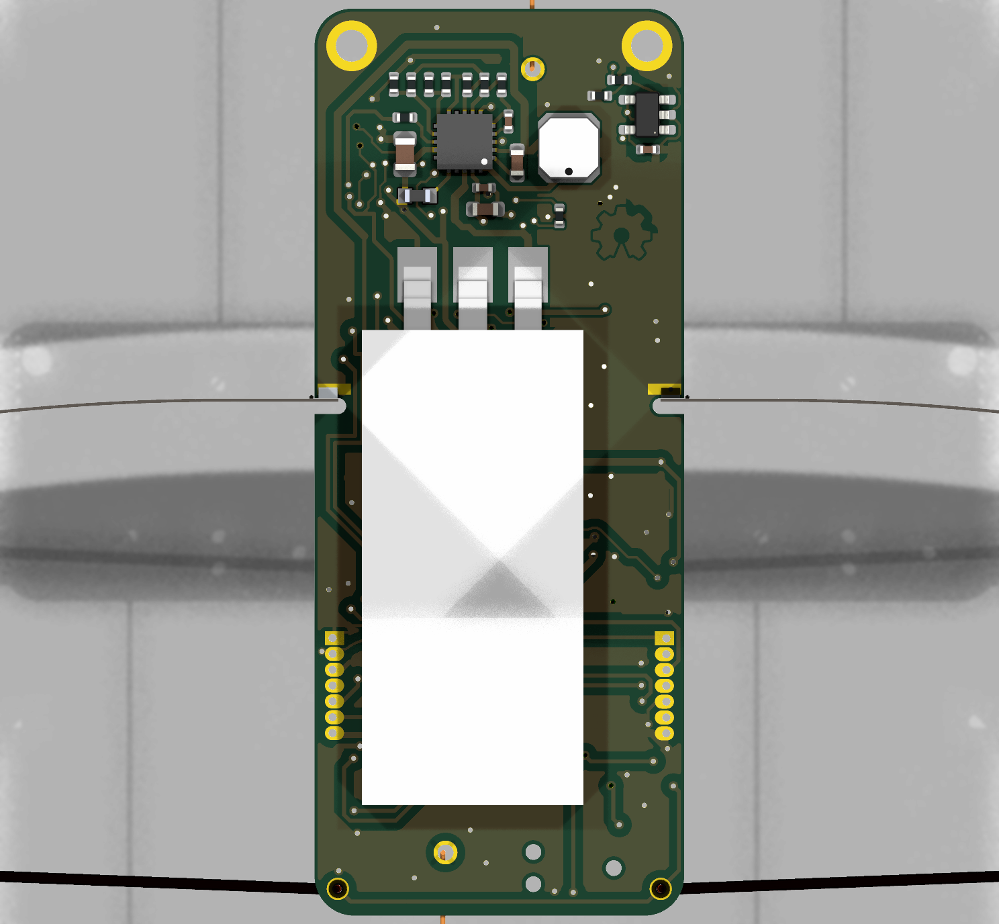
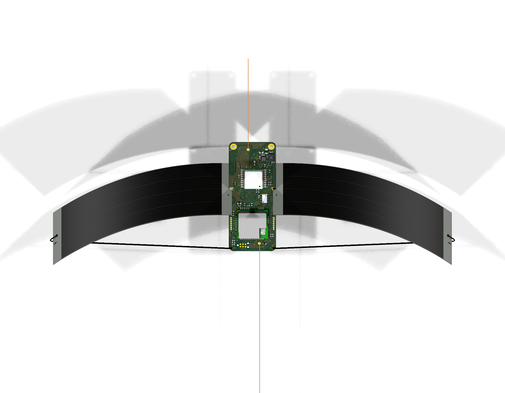

# Upward GNSS antenna revision

The v1.1 board restores the flown top antenna position and the upward 48 mm wire. Its feed runs around L1 with connected ground beside and beneath it. This preserves separation from the side solar panels without accepting the original switching-node crossing.

Current PCB SHA-256: `88f82c85d2d47b4aea2e7d7d2827c4a92c339788cc0d9c880dd6342ee0440c0a`.

## Changes to review

- AE2 returns to (62.882, 33.218) mm, 90 degrees. The wire and hole geometry remain unchanged.
- L1 moves 0.50 mm right to (60.603, 38.1865) mm. D3 moves to (58.8, 42.0) mm, 0 degrees. Other footprints retain their preceding placements, including the flat C5.
- A 0.45 mm rounded RF feed goes west of L1. Its 16.9634 mm length is 3.5241 mm longer than the original flown route. Upper solar and low-current balancing/sense branches move to preserve the rear reference.
- PICO and STRATOLINK groups move 0.6 and 0.4 mm left without changing the glyphs or losing editable F.Fab text.
- Small acute junctions and isolated ground flecks are removed. Local RF zones preserve the neighboring C1/C2/R2 thermal reliefs; R25.GND intentionally connects solidly beneath the RF projection.

The outline, 0.4 mm stackup, green mask, absent silkscreen, circuit, side solar mounts and component selection stay the same. The pilot still omits U6 only.

## Evidence

- [Root native checks](native/root-review.json): fresh KiCad 10 DRC, opens and schematic parity all zero; ERC zero unexcluded, with two documented exclusions. Existing generic ignored checks are enumerated rather than hidden.
- [Independent electrical and copper review](independent/README.md): pad/net scope, actual filled ground, artwork anchoring, reference continuity, thermals and bounded etching checks.
- [Routing and cleanup scope](rf/top-feed-review.md): exact moves, reproduction, ground geometry and remaining RF limits.
- [Power review](power/README.md): retained local converter topology, changed supply path resistance and unchanged component values.
- [Mechanical review](mechanics/README.md): modeled panel separation and bridle projection. Nominal models do not establish assembly tolerances or strength.
- [Manufacturing population/stencil check](manufacturing/package-verification.json): current source-derived pilot export, with only U6 and its 16 paste apertures omitted.
- [Whole-payload reception comparison](reception-test.md): the required physical test before claiming improved GNSS performance.

The [orientation note](orientation.md) explains why pointing a straight wire upward is not the same as aiming a patch antenna at the sky. The modeled minimum solar separation rises from about 5.50 mm for the side exit to 21.58 mm at the original top position. The suspension line must remain physically clear, including stretch and motion. Its actual depth and apex height have not been measured.

The saved geometry has no direct boost/buck switching trace crossing under RF. The nearest projected LBOOST edge remains about 0.167 mm away, so this is not an EMI-isolated antenna or a qualified uniform 50 ohm line. C10 bypass placement and FB1 maximum DCR remain separate supply follow-ups. Satellite count alone does not establish accuracy; compare fresh receiver C/N0, geometry, fix validity, acquisition and error against a reference.

## Native views

These renders show the complete CAD, including U6. The initial pilots omit U6. Close views crop the long antenna wires and panels; the assembly view crops the lower LoRa wire.

## Release boundaries

Use `hardware/pcb` and the matching `hardware/gerbers/v1.1-pilot` package. The earlier left-exit and intermediate top-left layouts are historical trials, not the current assembly. Their reports retain their own hashes. The routing-phase records under `rf/routing-phase` also deliberately describe the intermediate pre-cleanup hash; final checks describe the current hash above.

The JLC Y24 draft predates this revision. Upload the new package and review D3/L1 placement, both assembly faces and factory CAM before ordering. Planned quantity remains five PCBs, three assembled. No checkout or payment was made.
