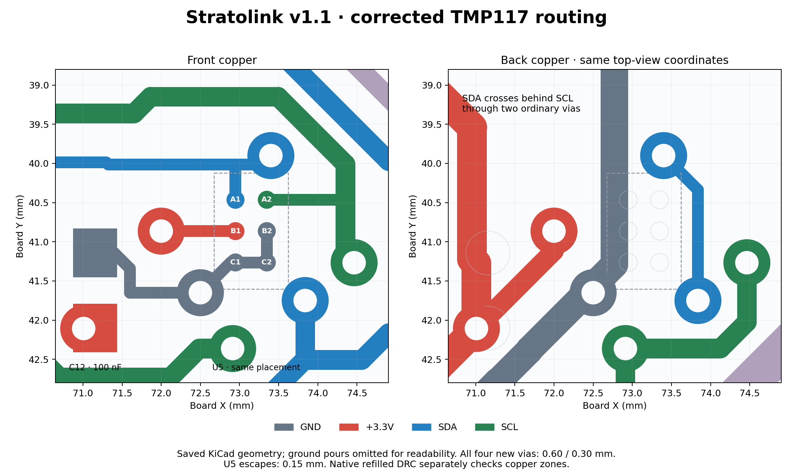

# Stratolink hardware — v1.1 working revision

Open [stratolink.kicad_pro](stratolink.kicad_pro) in KiCad 10. This is the canonical working project. Make subsequent v1.1 hardware changes here on `alpha/hardware-v1.1`, so the project Teddy reviews in KiCad stays current. Git preserves the earlier board revisions; the separate `../v1.1/` draft is superseded.

The first implemented change corrects U5's TMP117NAIYBGR DSBGA ball assignments and reroutes its local supply, ground and I²C connections. The precision sensor and existing C12 bypass stay in their original positions. The embedded schematic symbol and project-local reusable symbol are corrected together. The title block and copper revision label identify v1.1.

| Ball | Function | Connection |
| --- | --- | --- |
| A1 | SDA | SDA |
| A2 | SCL | SCL |
| B1 | V+ | +3.3 V |
| B2 | GND | GND |
| C1 | ADD0 | GND → address `0x48` |
| C2 | ALERT | GND; unused open-drain output, permitted by TI |

The new escape traces are 0.15 mm; four new vias use 0.60 mm copper / 0.30 mm drill. SDA uses a short back-layer crossover. C12 retains a local supply and ground path. That first repair preserved all 62 component placements and 239 pad geometries.

The TMP117 correction's recorded verification passed independent symbol/netlist/copper checks and a refilled 0.15 mm clearance screen with no new local violations. See the linked change record for the exact checked revision and evidence. This is a working design, **not a manufacturing release**: inherited ERC/DRC findings and physical pilot validation remain open. The working project retains v1's rule settings, including disabled global clearance checks; use the recorded enabled diagnostic screen when assessing this repair.

- [Prioritized v1.1 / v2 checklist](TODO.md)
- [Promotion and fresh checks on this project](../../analysis/v1_1_implementation_20261012/promotion/README.md)
- [Change record, checks and native review views](../../analysis/v1_1_implementation_20261012/README.md)
- [Independent electrical review](../../analysis/v1_1_implementation_20261012/review/electrical_review.md)

The second change removes MK1 (T3902), its R20 clock resistor and C13 bypass capacitor, their dedicated signal routing, and the microphone's acoustic hole/mask/paste features. The remaining 59 footprints retain their placement. U2 pins 31/32 are explicitly unconnected. The shared 3.3 V supply through the former C13 location remains continuous. See the [microphone removal and verification record](../../analysis/v1_1_microphone_20261012/README.md).

Build `firmware/` with `platformio run -e stratolink_v1_1` for this no-microphone hardware. It leaves PB3/PB4 quiet and reports acoustic unavailable. The existing `stratolink` environment continues to support fitted microphones on v1 boards. No firmware has been flashed as part of this CAD change.

The third change replaces J1/J2 with direct-solder solar contacts: open unplated GND notches near the middle, with front/back lands and ordinary stitching vias, plus one 0.7 mm positive wire hole near each lower corner. Both panels remain parallel. The old side wire-support holes are removed; upper suspension holes, the 0.4 mm stackup, outside dimensions and all 57 other footprints remain. See the [attachment, thickness and cost study](../../analysis/v1_1_solar_attachments_20261012/README.md) and [front view](../../analysis/v1_1_solar_attachments_20261012/front-3d.png).

The mounting refinement now uses **1.0 mm-wide × 2.0 mm-deep** rounded cuts. The upper bank has GND copper on both PCB faces and one stitching via per side. This preserves existing signal routes while increasing nominal straight solderable bank overlap from **0.8 to 1.3 mm**. The lower positive holes remain 0.7 mm. All other components stay in place. [Dimension study, native checks and assembly procedure](../../analysis/v1_1_solar_attachments_20261012/qualification/README.md).

The solar contacts carry [photo-scaled panel, wire and solder models](3d/solar/README.md) in KiCad’s 3D Viewer: **94 × 75 mm** panels, 7 mm straight roots, gentle downward curves, and centered 0.5 mm solid positive wires with formed ends. A calibrated grid in ZachTek's product photo provides overall size; thickness, terminal preparation and strength still require the first physical assembly. This is a prototype CAD revision, with inherited fabrication findings and joint/RF/thermal checks still open. Use one or two verified pilots before the larger batch.

Keep the corrected `sym-lib-table`, `fp-lib-table` and `lib/` with the project. Custom 3D models remain local; standard models use KiCad 10's model directory. Other imported libraries still have inherited drift, so avoid a blanket update of every footprint from the library before those checklist items are reviewed.

The upper suspension corners now use **2.0 mm plated holes with 3.2 mm ground rings**, replacing the two 2.701 mm unplated outline cutouts at the same centers. H1/H2 are board-only mechanical footprints, excluded from BOM and placement, with no paste. The outline, 0.4 mm stackup, existing components and routing stay unchanged. This gives about one-third more FR4 ligament after nominal plating allowance; actual string wear and assembled strength remain physical checks. [Geometry, bridle loads, simulation and independent verification](../../analysis/v1_1_suspension_20261012/README.md).
